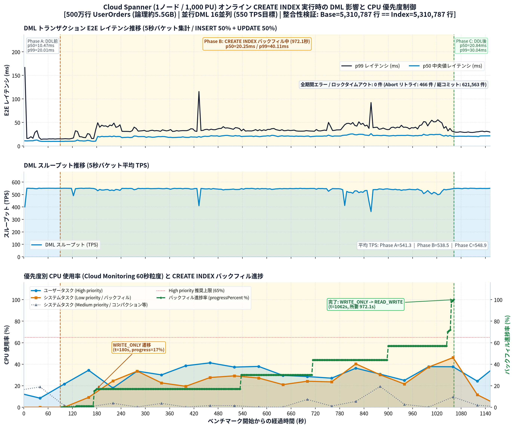

## tl;dr

- Spannerのスキーマ変更（DDL）は、期限付きのスキーマキャッシュ（スキーマリース）で共存世代を最大2つに絞り、`WRITE_ONLY`などの中間状態を挟むことで、開始時や切り替え完了時も含めてテーブルの排他ロックを取得せずに実行できます。
- 内部動作は「メタデータ変更のみ」「既存データの検証あり」「バックフィルあり」に分かれ、たとえば`DEFAULT`付きの`ADD COLUMN`は一般的なRDBの最新仕様と異なり全行バックフィルを伴います。
- データ更新（DML）は阻害しない一方で、CPU余力不足による遅延や後続マイグレーションの直列待ちといった運用上の考慮点があり、事前の一時スケールアウトやDDLバッチの組み方で所要時間を短縮できます。

## はじめに

MySQLやPostgreSQLなどの一般的なリレーショナルデータベース（以下、RDB）でも、近年はオンラインDDLが大きく進化しており、多くのスキーマ変更をテーブル全体の長時間ロックなしで実行できるようになっています。一方で、スキーマ変更の開始時やコミット時に短時間のメタデータロック（MySQLのMDL）や排他ロック（PostgreSQLの`ACCESS EXCLUSIVE`など）が必要になる場面は残っています。そのため、たまたま実行時間の長いトランザクションやバッチクエリーと重なると、ロック取得待ちの後ろに通常の参照・更新クエリーまで連鎖的に詰まり、結果としてサービス影響を避けるために夜間メンテナンス枠の調整が必要になることは珍しくありません。

これに対してSpannerは、大規模なテーブルへのインデックス追加などを含め、データ更新を止めずにオンラインでDDLを実行できるデータベースとして知られています[^1]。実際にメルカリ様の技術ブログでも、本番稼働中の大規模なSpannerテーブルに対してダウンタイムなしで57時間かけてインデックスを追加した事例が紹介されています[^2]。ただ、RDBの運用経験がある方ほど「切り替えの瞬間すら本当に排他ロックを取らないのか」「裏側で大量データを走査している最中に更新性能へ悪影響は出ないのか」と疑問に思われるのではないでしょうか。

本稿では、MySQLやPostgreSQLの運用・開発経験があるデータベース管理者（DBA）やソフトウェア開発者の方に向けて、SpannerのDDLがデータ更新を阻害しない内部アーキテクチャを整理します。その上で、主要なDDLパターンごとの挙動の違い、1ノード環境での実測結果とモニタリング方法、そして本番運用で注意したい点と短時間で終わらせるための勘所を解説します。なお、本稿のSQL例はGoogleSQL方言で記載していますが、PostgreSQLインターフェースでも裏側のスキーマ変更の仕組みは共通です。

## なぜSpannerのDDLはデータ更新を止めないのか

マニュアルには、Spannerのスキーマ更新について以下のような説明がされています[^1]。

> Schema updates in Spanner don't require downtime. When you issue a batch of DDL statements to a Spanner database, you can continue writing and reading from the database without interruption while Spanner applies the update as a long-running operation.

言い換えると、DDLを実行してもテーブルや行をロックしてアプリケーションのクエリーを待たせる区間がなく、通常の読み書きを受け付けたまま裏側の長時間実行オペレーションとしてスキーマ変更を進めていく動作です。なぜ切り替えの瞬間を含めて排他ロックが不要なのかは、Spannerの「スキーマバージョニングと段階的遷移」および「スプリット単位での低優先度実行」の2つに分けると理解しやすくなります。

### スキーマリースと中間状態によるロックフリーな切り替え

単一ノードを基本とする一般的なRDBでも、PostgreSQLの`CREATE INDEX CONCURRENTLY`のように排他ロックを回避してインデックスを構築できる仕組みはありますが、MySQLのオンラインDDLにおける排他MDLやPostgreSQLの`ALTER TABLE`など多くのDDLでは、定義を切り替える瞬間に実行中トランザクションの完了を待ち合わせる同期点が必要になります。一方、複数サーバー（ノード）にデータが分散しているSpannerで全ノード一斉の排他ロックを取ろうとすると、その間システム全体の書き込みが止まってしまいます。

そこでSpannerの基盤となっているGoogleの公開論文（Online, Asynchronous Schema Change in F1）では、全ノードで同時にスキーマを切り替えるのではなく、「スキーマリース（Schema Lease）」という期限付きのキャッシュによって、クラスター内で同時に存在するスキーマバージョンを常に隣接する最大2世代までに制限する方式を採っています[^3]。

たとえば既存の大きなテーブルにセカンダリインデックスを追加する場合、いきなり「存在しない状態（`Absent`）」から「読み書き可能な公開状態（`READ_WRITE` / 論文上の`Public`）」へ切り替えるのではなく、間に段階的な中間状態を挟みます[^3][^4]。具体的には、まず空のインデックス構造を準備（`PREPARE`）したあと、ユーザーからの読み取りにはまだ使わず書き込みだけを二重反映する`WRITE_ONLY`状態へ移行します。

```html-embed
<div class="diagram">
  <div class="cmp-grid">
    <div class="cmp-card card-rdb">
      <div class="card-head">
        <span class="tag tag-rdb">RDBの排他切替型DDL</span>
        <span class="card-title">切り替え同期点での排他ロック待ち</span>
      </div>
      <div class="card-desc">処理本体がオンラインでも、開始・完了時の排他ロック取得（MySQLのMDLなど）が長期トランザクションと重なると後続DMLが連鎖的に詰まります。</div>
      <div class="flow-list">
        <div class="step-row row-ok">
          <span class="step-badge b-blue">先行Tx</span>
          <span>集計クエリーや長期トランザクションが共有ロックを保持</span>
        </div>
        <div class="step-row row-block">
          <span class="step-badge b-red">DDL切替</span>
          <span>排他ロックの取得を要求して先行Txの終了を待機</span>
        </div>
        <div class="step-row row-block">
          <span class="step-badge b-red">後続DML</span>
          <span>排他ロック待ちの後ろに並び、通常の更新・参照も待機</span>
        </div>
      </div>
    </div>

    <div class="cmp-card card-spanner">
      <div class="card-head">
        <span class="tag tag-sp">Spanner</span>
        <span class="card-title">中間状態（WRITE_ONLY）による無停止移行</span>
      </div>
      <div class="card-desc">スキーマリースで隣接2世代以内の共存を許容し、排他ロックを取らずに段階遷移で整合性を保ちます。</div>
      <div class="flow-list">
        <div class="step-row row-ok">
          <span class="step-badge b-blue">1. PREPARE</span>
          <span>空のインデックス構造を作成（DMLは通常通り継続）</span>
        </div>
        <div class="step-row row-work">
          <span class="step-badge b-amber">2. WRITE_ONLY</span>
          <span>新着DMLを二重書き込みしつつ、過去分を裏でバックフィル</span>
        </div>
        <div class="step-row row-done">
          <span class="step-badge b-green">3. READ_WRITE</span>
          <span>全データ揃い次第、クエリーから参照可能な状態へ公開</span>
        </div>
      </div>
    </div>
  </div>
</div>

<style>
  .diagram {
    --bg: #f8fafc; --surface: #ffffff; --surface-sub: #f1f5f9;
    --text: #0f172a; --text-muted: #475569; --border: #cbd5e1;
    --primary: #0284c7; --primary-bg: #e0f2fe;
    --green: #15803d; --green-bg: #dcfce7;
    --amber: #b45309; --amber-bg: #fef3c7;
    --red: #b91c1c; --red-bg: #fee2e2;
    box-sizing: border-box; padding: 12px; background: var(--bg); color: var(--text);
    border: 1px solid var(--border); border-radius: 10px;
    font-family: -apple-system, BlinkMacSystemFont, "Hiragino Sans", "Noto Sans JP", sans-serif;
    font-size: 12px; line-height: 1.38;
  }
  [data-theme="dark"] .diagram {
    --bg: #0f172a; --surface: #1e293b; --surface-sub: #162032;
    --text: #f1f5f9; --text-muted: #94a3b8; --border: #334155;
    --primary: #38bdf8; --primary-bg: #0c4a6e;
    --green: #4ade80; --green-bg: #064e3b;
    --amber: #fbbf24; --amber-bg: #451a03;
    --red: #f87171; --red-bg: #450a0a;
  }
  .diagram *, .diagram *::before, .diagram *::after { box-sizing: border-box; }
  .cmp-grid { display: grid; grid-template-columns: 1fr 1fr; gap: 10px; }
  .cmp-card {
    background: var(--surface); border: 1px solid var(--border); border-radius: 8px;
    padding: 10px; display: flex; flex-direction: column; gap: 6px;
  }
  .card-spanner { border: 1.5px solid var(--primary); }
  .card-head { display: flex; align-items: center; gap: 6px; flex-wrap: wrap; }
  .tag { display: inline-block; padding: 1px 6px; border-radius: 4px; font-size: 12px; font-weight: 700; }
  .tag-rdb { background: var(--surface-sub); color: var(--text-muted); border: 1px solid var(--border); }
  .tag-sp { background: var(--primary-bg); color: var(--primary); }
  .card-title { font-size: 13px; font-weight: 700; }
  .card-desc { font-size: 12px; color: var(--text-muted); }
  .flow-list { display: flex; flex-direction: column; gap: 5px; margin-top: auto; }
  .step-row {
    background: var(--surface-sub); border: 1px solid var(--border); border-radius: 6px;
    padding: 6px 8px; display: flex; align-items: center; gap: 6px; font-size: 12px;
  }
  .row-ok { border-left: 3px solid var(--primary); }
  .row-block { border-left: 3px dashed var(--red); background: var(--red-bg); }
  .row-work { border-left: 3px solid var(--amber); background: var(--amber-bg); }
  .row-done { border-left: 3px solid var(--green); }
  .step-badge {
    display: inline-block; padding: 1px 5px; border-radius: 4px; font-size: 12px; font-weight: 700;
    white-space: nowrap; flex-shrink: 0; font-family: ui-monospace, SFMono-Regular, Menlo, monospace;
  }
  .b-blue { background: var(--primary-bg); color: var(--primary); }
  .b-red { background: var(--surface); color: var(--red); border: 1px solid var(--red); }
  .b-amber { background: var(--surface); color: var(--amber); border: 1px solid var(--amber); }
  .b-green { background: var(--green-bg); color: var(--green); }
  @media (max-width: 640px) {
    .diagram { padding: 8px; line-height: 1.3; }
    .cmp-grid { grid-template-columns: 1fr; gap: 8px; }
    .cmp-card { padding: 8px; gap: 4px; }
    .card-desc { display: none; }
    .step-row { padding: 4px 6px; }
  }
</style>
```

全サーバーが`WRITE_ONLY`に入ったことがリース期限によって保証されると、それ以降に到着するアプリケーションの`INSERT`・`UPDATE`・`DELETE`はすべて新インデックスにも自動的に反映されます。あとはマルチバージョン並行性制御（MVCC）のスナップショットを使って過去の行データをバックグラウンドで埋めていけば、新着の更新を取りこぼすことなく`READ_WRITE`へ昇格できます[^1][^3]。削除（`DROP`）時はこの逆順をたどるため、どの瞬間を切り取ってもテーブル全体を止める排他ロックが不要になります。

### スプリット単位の分散処理とタスク優先度制御

もう1つの仕組みが、コンピュートリソースの優先度制御です。Spannerはプライマリキーの範囲ごとにデータを「スプリット（Split）」に分割して複数ノードで分担しており、インデックスのバックフィルや既存データの検証もスプリット単位で分散して進みます[^5][^6]。

このとき、Spannerは処理の要求元（ユーザーかシステムか）と優先度（`High` / `Medium` / `Low`）を明確に区別してスケジューリングします[^7]。マニュアルでは、通常のアプリケーションからの読み書きリクエストはデフォルトで`High`優先度のユーザータスクとして動くのに対し、スキーマ変更に伴う既存データの検証は`Medium`優先度、インデックスや生成列のバックフィルは`Low`優先度のシステムタスクとして実行されると説明されています[^7]。

`Low`や`Medium`のシステムタスクは、インスタンスのCPUが空いているときには最大100%までリソースを使って処理を進めますが、`High`優先度のユーザータスクが到着すると即座にCPUを明け渡します[^7]。そのため、データ量の大きいバックフィルが裏で動いていても、通常時のオンライン更新とCPUリソースが競合して遅延することを防げる設計になっています。

## 主要なDDLパターン別の内部動作と注意点

SpannerのDDLはすべてオンラインで実行できるものの、すべての操作が数秒で終わるわけではありません。内部動作によって、所要時間とリソース消費は大きく4つのカテゴリに分かれます[^1][^8]。

| 分類 | 主なDDL操作（GoogleSQL例） | 内部動作とシステム優先度 | 所要時間の目安 | RDB運用者が気をつけたい点 |
| :--- | :--- | :--- | :---: | :--- |
| メタデータのみ | `CREATE TABLE` / `DROP TABLE`<br>`ADD COLUMN`（`NULL`許容・`DEFAULT`なし）<br>`ALTER COLUMN SET DEFAULT`<br>`STRING` / `BYTES`の長さ拡大<br>`DROP COLUMN` / `DROP INDEX` | スキーマ定義の更新のみ<br>（データ走査なし） | 数秒〜数分 | `DROP`後もデータ保持期間（`version_retention_period`）の経過とバックグラウンドのコンパクション完了まではストレージ容量が解放されない |
| データ検証あり<br>（Validation） | `NOT NULL`の追加（非キー列）<br>`CHECK`制約の追加<br>`STRING` / `BYTES`の長さ縮小<br>`BYTES`から`STRING`への型変更 | 既存全行の整合性スキャン<br>（`Medium`優先度） | 数分〜数時間 | 開始直後から新規書き込みに制約が効く。既存行に違反が1件でもあるとロールバックされる |
| バックフィルあり<br>（Backfill） | 既存表への`CREATE INDEX`<br>`ALTER INDEX ADD STORED COLUMN`<br>`DEFAULT`付きの`ADD COLUMN`<br>`STORED`生成列の追加<br>既存表への`FOREIGN KEY`追加 | 既存全行の読み出しと書き込み<br>（`Low`優先度 ※外部キーは検証も実施） | 数分〜数十時間 | データ量と空きCPUに比例して時間がかかり、同一バッチの後続文や完了待ちを行う後続マイグレーションが長時間待たされやすい |
| 単体DDL不可 | 主キー列の追加・削除・順序変更<br>`INT64`と`STRING`間の型変更<br>`STRING(36)`と`UUID`間の型変更 | DB側での自動テーブル再構築なし | — | 新カラム・新テーブル追加と二重書き、パーティション化DML（PDML）による段階移行が必要 |

表の中でも、MySQLやPostgreSQLの感覚で実行すると想定外の挙動になりやすいポイントを3つ補足します。

### DEFAULT付きADD COLUMNとSET DEFAULTの違い

MySQL 8.0.12以降（`ALGORITHM=INSTANT`）やPostgreSQL 11以降では、定数の`DEFAULT`を指定した`ADD COLUMN`はメタデータ変更のみで即座に完了するよう改良されています。一方で、Spannerで既存テーブルに`ADD COLUMN ... DEFAULT (...)`を実行すると、既存の全行に対して式を評価して値を書き込む非同期バックフィルが発生します[^8]。その代わり、この構文を使う場合は既存テーブルに対しても1文で`NOT NULL`付きのカラムを追加できます[^8]。なお、バックフィル中の`WRITE_ONLY`状態では追加したカラムをまだクエリーから読み取れないため、そのカラムを参照するアプリケーションのデプロイはDDL完了後に行います[^4]。

もし数億行あるテーブルに対して「既存行は`NULL`のままで構わないので、バックフィルを走らせずに今後の`INSERT`にだけデフォルト値を適用したい」という場合は、以下のように2段階に分けて実行します[^8]。

```sql
-- 1. DEFAULTなしのNULL許容カラムとして追加（メタデータ変更のみ）
ALTER TABLE UserOrders ADD COLUMN campaign_code STRING(32);

-- 2. デフォルト値を後から設定（メタデータ変更のみ・既存行の書き換えなし）
ALTER TABLE UserOrders ALTER COLUMN campaign_code SET DEFAULT ('standard');
```

`ALTER COLUMN ... SET DEFAULT`は既存データを書き換えない仕様であるため、どちらもメタデータ変更のみで短時間に完了します[^8]。なお、既存の`NULL`許容カラムに対して後から`ALTER COLUMN`で`NOT NULL`を付与する場合はバックフィルが行われないため、1トランザクションの更新上限を回避して大量行を分割更新できるパーティション化DML（PDML）などで事前に既存の`NULL`行を埋めておかないと、データ検証でエラーになります[^8]。

### 制約追加（NOT NULL・CHECK・外部キー）の検証タイミング

既存のカラムへの`NOT NULL`追加やカラム長の縮小、`CHECK`制約の追加では、バックグラウンドで既存全行が制約を満たしているかのスキャン検証が行われます[^1]。ここで押さえておきたいのは、検証が完了するのを待たず、DDLを開始したほぼ直後から新しい書き込みリクエストに対して制約チェックが有効になる点です（前述した`WRITE_ONLY`段階での制約適用に相当します）[^1][^3]。もし既存データに1件でも違反が見つかって最終的にDDLが失敗した場合でも、検証中に届いた違反データの書き込みはすでに拒否された後になるため、本番実行前の事前クエリー確認が欠かせません[^9]。

また、既存テーブルへの通常の外部キー（`FOREIGN KEY`、参照整合性を強制するデフォルト設定）の追加は、単なるデータ検証だけでは終わりません。主キーをそのまま利用できない列に対して参照元・参照先に最大2つのバッキングインデックスを自動生成してバックフィルします[^10]。外部キーではこのインデックスのバックフィル完了を待ってから、新規書き込みへの制約強制と既存データの参照整合性検証が始まるため、`CREATE INDEX`と同等以上に重くなりやすい操作です[^4][^10]。

### 直接ALTERできない変更（主キー変更・非互換な型変更）

MySQLやPostgreSQLでは、データ型の大幅な変更やプライマリキーの再定義であっても`ALGORITHM=COPY`やテーブル書き換えロックを許容すれば1本の`ALTER TABLE`で実行できます。それに対してSpannerは、システム側でテーブル全体を別領域へ丸ごと作り直すような暗黙のコピーDDLを持たず、サポートされていない非互換な型変換やプライマリキー構成の変更はDDL自体がエラーになります[^1]。これらを変更したい場合は、新しいカラムまたは新しいテーブルを追加し、アプリケーションからの二重書きとPDMLなどによるデータ移行を経て切り替える手順をとります。

## 実機検証：DML継続中のインデックス追加とモニタリング

ここまでの仕組みを踏まえ、実際にDMLが流れ続けている環境で重いDDLを実行したときの挙動を実測データで確認します。

:::message
本稿に掲載している所要時間やレイテンシの測定値は、検証環境で特定のワークロードを実行した際の参考値であり、スキーマ構造やデータ分布、負荷状況によって数値は変動します。
:::

検証環境として`regional-asia-northeast1`（東京）に1ノード（`1,000 Processing Units`、`STANDARD`エディション）のインスタンスを作成し、以下の`UserOrders`テーブルにランダムUUID主キーで500万行（1行あたり約1.1KB、論理サイズ約5.5GB）を投入しました。

```sql:schema.sql
CREATE TABLE UserOrders (
  order_id STRING(36) NOT NULL,
  user_id INT64 NOT NULL,
  category_id INT64 NOT NULL,
  status STRING(16) NOT NULL,
  amount INT64 NOT NULL,
  description STRING(512) NOT NULL,
  metadata STRING(512) NOT NULL,
  updated_at TIMESTAMP NOT NULL OPTIONS (allow_commit_timestamp=true)
) PRIMARY KEY (order_id);
```

このテーブルに対し、16並列のGoクライアントから新規行の`INSERT`と既存行の`UPDATE`を50%ずつの比率で流し、合計約540 TPS（ユーザータスクCPU約30%）の負荷を継続させました。その状態で開始90秒時点から、以下の`STORING`句（カバリングインデックス用の保持列）付きセカンダリインデックスを追加しています。なお、並行する`UPDATE`はインデックスのキー列や保持列に含まれる`user_id`・`status`・`amount`・`updated_at`を更新対象としています。

```sql
CREATE INDEX idx_user_orders_user_updated
ON UserOrders(user_id, updated_at DESC)
STORING (category_id, status, amount, description);
```

ベンチマーク開始からインデックス追加の完了後90秒までを同一の時間軸でプロットした結果が以下のグラフです。


*1ノード環境で約540 TPSのDMLを継続しながらCREATE INDEXを実行した際のレイテンシ・スループット・CPU使用率・進捗率の推移*

各フェーズの集計値は以下の通りです。全期間（約19分間、総コミット`621,563`件）を通じて、ロック待ちタイムアウトやトランザクション失敗エラーは`0`件でした。

| フェーズ | 計測時間 | コミット件数 | 平均スループット | DML p50 | DML p99 | エラー件数 |
| :--- | :---: | :---: | :---: | :---: | :---: | :---: |
| Phase A（DDL実行前） | 90.0秒 | 48,720件 | 541.3 TPS | 10.47 ms | 20.01 ms | 0件 |
| Phase B（`CREATE INDEX`実行中） | 972.1秒 | 523,445件 | 538.5 TPS | 20.25 ms | 40.11 ms | 0件 |
| Phase C（DDL完了後） | 90.0秒 | 49,398件 | 548.9 TPS | 20.84 ms | 30.04 ms | 0件 |

また、メイン計測の終了後に同じテーブル（並行DMLで増えた分を含め`5,310,787`行）に対して代表的な3種類のDDLを順番に単発実行し、所要時間と`INFORMATION_SCHEMA`上の状態遷移を記録しました。カラムや`CHECK`制約では、適用完了の状態が`COMMITTED`として表されます。

| パターン | 実行したDDL文 | 所要時間 | 観測された状態遷移 |
| :--- | :--- | :---: | :--- |
| メタデータのみ | `ALTER TABLE UserOrders ADD COLUMN note STRING(128)` | 9.4秒 | `COMMITTED` |
| データ検証あり | `ALTER TABLE UserOrders ADD CONSTRAINT chk_amount_nonneg CHECK (amount >= 0)` | 15.8秒 | `VALIDATING` ➔ `COMMITTED` |
| バックフィルあり | `ALTER TABLE UserOrders ADD COLUMN priority_tier INT64 NOT NULL DEFAULT (1)` | 319.5秒 | `WRITE_ONLY` ➔ `COMMITTED` |

同じカラム追加であっても、`DEFAULT`なしの`ADD COLUMN`が`9.4秒`で終わったのに対し、`DEFAULT (1)`を付けた`ADD COLUMN`は`Low`優先度のシステムCPUをピーク`34.7%`まで使いながら全531万行への書き込みを行い、完了に`319.5秒`（約5分20秒）かかっています。

### スループットとレイテンシの推移から分かること

#### 切り替え境界でのスループット維持とクライアントリトライ

中段のスループット推移を見ると、DDL開始時（`t=90秒`）やバックフィル完了・公開の切り替え時（`t=1062秒`）に排他ロック待ちでスループットが途切れる区間はなく、Phase B全体でも平均`538.5 TPS`を維持しています。検証終了直後にベーステーブルと新インデックスの件数を比較したところ、並行更新分を含めどちらも`5,310,787`行で一致していました。

なお、全期間を通じて計`466`件（総コミット数の`0.07%`）、そのうちDDL実行中のPhase Bで`463`件（`0.09%`）のトランザクションAbortが発生していました。約9割にあたる`409`件は内部のスキーマ状態が切り替わる境界（`t=125〜180秒`および`t=1050〜1060秒`付近）に集中していましたが、いずれもSpannerクライアントライブラリの標準リトライによって再実行され、アプリケーション側のエラーにはなっていません。ロックで後続リクエストを並ばせる代わりに、境界をまたいだごく一部のトランザクションだけをリトライさせる動きと言えます。

#### WRITE_ONLY以降の二重書き込みによるレイテンシ上昇

上段のレイテンシ推移を見ると、DDL投入直後の`PREPARE`段階（`t=90〜180秒`）ではDMLのp50レイテンシは約`10 ms`のままですが、前半の図で見た`WRITE_ONLY`状態に入った`t=180秒`直後から`20.25 ms`へ上昇し、バックフィルが終わったPhase Cでも`20.84 ms`のまま維持されています。一見するとバックフィルの負荷で書き込みが遅くなったように見えますが、完了後も同じレイテンシであることから分かる通り、これは`WRITE_ONLY`になった時点からアプリケーション自身の`INSERT` / `UPDATE`トランザクションがベーステーブルとは別スプリットにある新インデックスへの二重書き込み（2フェーズコミット）を開始したためです。セカンダリインデックスを追加すると、バックフィル中だけでなく完了後もインデックス維持の書き込みコストが定常的に加わる点は設計時に見込んでおく必要があります。

### 進捗とリソースのモニタリング方法

実行に数十分から数時間かかる大規模DDLを運用する際は、「いま何%進んでいるか」「どの状態にあるか」「CPUをどれだけ使っているか」の3つを組み合わせて監視します。

まず、オペレーション全体の進捗率（`progressPercent`）やスロットリングの有無は、Google Cloudコンソールの「オペレーション」画面または`gcloud spanner operations`コマンドで確認できます[^6][^9]。以下は今回のバックフィル実行中に取得したコマンド出力の抜粋です。

```yaml
# 実行中のDDLオペレーション一覧の取得
$ gcloud spanner operations list \
    --instance=ddl-study-1node --database=benchdb \
    --type=DATABASE_UPDATE_DDL --project=PROJECT_ID --limit=5

OPERATION_ID               STATEMENTS                                                    DONE   @TYPE
_auto_op_871464a4b0d2e8f0  CREATE INDEX idx_user_orders_user_updated ON UserOrders(...)  False  UpdateDatabaseDdlMetadata

# オペレーションIDを指定した詳細・進捗率の確認（バックフィル途中）
$ gcloud spanner operations describe _auto_op_871464a4b0d2e8f0 \
    --instance=ddl-study-1node --database=benchdb --project=PROJECT_ID

metadata:
  '@type': type.googleapis.com/google.spanner.admin.database.v1.UpdateDatabaseDdlMetadata
  progress:
  - progressPercent: 44
    startTime: '2026-11-18T04:53:52.497524Z'
  statements:
  - CREATE INDEX idx_user_orders_user_updated ON UserOrders(user_id, updated_at DESC)
    STORING (category_id, status, amount, description)
```

次に、SQLから対象オブジェクトの内部状態を確認したい場合は`INFORMATION_SCHEMA`を参照します[^4][^11]。対象ごとに確認するビュー・列名と主な状態遷移は以下の通りです。

| 確認対象 | 参照するビューと列名 | 主な状態遷移 |
| :--- | :--- | :--- |
| セカンダリインデックス | `INFORMATION_SCHEMA.INDEXES`の`INDEX_STATE`列 | `PREPARE` ➔ `WRITE_ONLY` ➔ `WRITE_ONLY_CLEANUP`（公開直前の整理） ➔ `READ_WRITE` |
| `DEFAULT`付き追加列・生成列 | `INFORMATION_SCHEMA.COLUMNS`の`SPANNER_STATE`列 | `WRITE_ONLY` ➔ `COMMITTED` |
| `CHECK`制約 | `INFORMATION_SCHEMA.CHECK_CONSTRAINTS`の`SPANNER_STATE`列 | `VALIDATING` ➔ `COMMITTED` |

```sql
-- 作成中インデックスの状態確認（バックフィル中はWRITE_ONLY、完了後はREAD_WRITE）
SELECT INDEX_NAME, INDEX_STATE
FROM INFORMATION_SCHEMA.INDEXES
WHERE TABLE_NAME = 'UserOrders';
```

そしてリソース負荷の監視には、Cloud Monitoringの優先度別CPU使用率メトリクス（`spanner.googleapis.com/instance/cpu/utilization_by_priority`）を使います[^7][^12]。`is_system`ラベルと`priority`ラベルでグループ化すると、今回のグラフ下段のようにオンライン処理（`is_system=false, priority=high`）とバックフィル（`is_system=true, priority=low`）、データ検証やコンパクション（`is_system=true, priority=medium`）の内訳を切り分けて観察できます。

## 本番運用で注意するべき点

排他ロックによるブロッキングが起きないからといって、本番環境でいつでも無制限に重いDDLを流してよいわけではありません。特に考慮が必要になるのは、インスタンスのCPU余力と、複数のDDLを実行する際の順序制御です。

### インスタンスのCPU余力と優先度引き上げの仕組み

バックフィル（`Low`優先度）やデータ検証（`Medium`優先度）は空きCPUを使って進むため、普段から`High`優先度のCPU使用率が高止まりしているインスタンスで大規模DDLを実行すると、システムタスクになかなかCPUが回らず、完了までに想定以上の長時間（数十時間など）を要することになります[^7]。

さらに注意したいのが、CPU不足が長時間続いた場合の挙動です。マニュアルには以下のような記載があります[^7]。

> If Spanner cannot complete its low-priority system tasks within a certain time window—on the order of several hours to a day—due to insufficient compute capacity, Spanner might increase the priority of the system tasks. This change affects the performance of user tasks.

つまり、コンピュート容量が足りないまま数時間から1日程度にわたってシステムタスクを完了できない状態が続くと、Spannerはデータベースの健全性を維持するためにシステムタスクの優先度を引き上げることがあり、その段階に至るとオンラインのユーザータスクのレイテンシにも影響が及びます[^7]。大規模DDLを安全に流す上でも、公式が推奨するCPU使用率の上限目安を守って余力を確保しておくことが前提になります[^7]。具体的には、`High`優先度CPUをリージョナル構成で65%未満、デュアルおよびマルチリージョン構成でリージョンあたり45%未満に抑え、システムタスクを含む総CPU使用率の24時間移動平均も90%未満に保つことが推奨されています[^7]。

### 後続マイグレーションの直列待ち・競合制限とバッチ上限

もう1つ実務で引っかかりやすいのが、複数のDDLを流す際の順序制御と待ち時間です。バックフィル中もアプリケーションからのDMLは止まりませんが、異なるバッチのDDLを並行送信するとSpanner内部で文の結合や適用順序の入れ替えが起こりうるため、公式ベストプラクティスでは先行するDDLオペレーションの完了を待ってから次のリクエストを送る直列運用が推奨されています[^9]。一般的なマイグレーションツールも先行オペレーションの完了を待つため、完了に5時間かかる`CREATE INDEX`を流した直後に別機能のリリースで軽い`ADD COLUMN`を実行しようとすると、デプロイパイプライン側が長時間待たされることになります。

また、完了を待たずに別バッチを並行送信した場合でも、データ検証中の対象テーブルなどへの競合変更は制限されます[^1]。さらに短期間に多数のスキーマ変更を積み上げると、内部スキーマバージョンの保持上限に達してキューの処理にスロットリング（`UpdateDatabaseDdlMetadata.throttled`）がかかることもあります[^9]。

あわせて、DDLバッチの仕様と上限も押さえておく必要があります[^9]。

- 1つのDDLバッチに複数の文を含めた場合、先頭から順番に直列適用されます。途中の文でエラーが発生するとその文自体はロールバックされ後続の文はキャンセルされますが、同じバッチ内でそれより前に適用完了していた文はロールバックされません。
- バックフィルやデータ検証を伴うDDL文は、1つのバッチあたり最大10文までに制限されています。
- バックフィルを伴うインデックス作成は1つにつき複数の内部スキーマバージョンを消費するため、バッチの分け方にかかわらず「1日あたり最大3個まで」に抑えることが公式の目安として推奨されています。

なお、どうしても進行中のバックフィルやデータ検証を中断して後続作業を優先したい場合は、`gcloud spanner operations cancel`コマンドで実行中のDDLオペレーションをキャンセルできます[^6][^9]。複数インデックス作成バッチの途中でキャンセルした場合、すでに作成完了していたインデックスはそのまま残ります[^6]。

## 大規模DDLを短時間で終わらせるには

最後に、バックフィルや検証を伴う大規模DDLの所要時間をできるだけ短縮するための実践的なアプローチを整理します。

### 事前の一時スケールアウトと実行時間帯の選択

インデックスのバックフィル速度は「対象データ量」「インスタンスのコンピュート容量」「実行中のオンライン負荷」の3つで決まります[^6]。バックフィルはスプリットごとに分散して動き、空いているCPUがあればそれを最大限使って並列処理を進めるため、まずはオンラインのトラフィックが落ち着く時間帯を選ぶのが基本です[^7]。

その上で、データ量が大きく数時間以上かかりそうな場合には、DDLを実行する前に一時的にノード数（またはProcessing Units）をスケールアウトしてシステムタスクが使えるCPU余力を広げ、バックフィル完了後に元のノード数へ戻す運用が有効です[^6][^7]。事前にスケールアウトしておくことで、スプリットの再配置とコンピュート余力の確保が済んだ状態で最初から高い並列度でバックフィルを走らせることができます。

### DDLバッチを「まとめる場面」と「分ける場面」の使い分け

複数のインデックス追加を含むDDLを実行する際、1つのバッチ（1回の`UpdateDatabaseDdl`リクエスト）にまとめるべきか別バッチに分けるべきかは、「新規テーブルの作成時」か「既存の大規模テーブルに独立した複数のインデックスを追加する場面」かで使い分けます[^9]。

```html-embed
<div class="diagram">
  <div class="batch-grid">
    <div class="b-card b-good">
      <div class="b-head">
        <span class="b-tag t-green">新規テーブル作成時</span>
        <span class="b-title">同一バッチで直後にまとめる</span>
      </div>
      <div class="b-explain">ベーステーブルが空であることを保証できるため、バックフィル自体をスキップして単一スキーマバージョンで完了します。</div>
      <div class="sql-box">
        <div class="sql-label">1つのDDLバッチとして一括送信</div>
        <code>CREATE TABLE Orders (...);</code>
        <code>CREATE INDEX idx_user ON Orders(user_id);</code>
        <code>CREATE INDEX idx_created ON Orders(created_at);</code>
      </div>
      <div class="b-foot foot-green">結果：バックフィルなし（数分で完了）</div>
    </div>

    <div class="b-card b-par">
      <div class="b-head">
        <span class="b-tag t-blue">既存大テーブルへの複数INDEX</span>
        <span class="b-title">独立したINDEXのみ別バッチで並列化</span>
      </div>
      <div class="b-explain">1バッチに入れると1本ずつ直列にバックフィルされるため、CPU余力がある場合は個別バッチで並列進行させます。</div>
      <div class="sql-box">
        <div class="sql-label">順序依存のない独立INDEXを個別送信（1日3個目安）</div>
        <code>Batch 1: CREATE INDEX idx_a ON BigTable(col_a);</code>
        <code>Batch 2: CREATE INDEX idx_b ON BigTable(col_b);</code>
      </div>
      <div class="b-foot foot-amber">結果：空きCPUの範囲でバックフィルが並列進行</div>
    </div>
  </div>
</div>

<style>
  .diagram {
    --bg: #f8fafc; --surface: #ffffff; --surface-sub: #f1f5f9;
    --text: #0f172a; --text-muted: #475569; --border: #cbd5e1;
    --primary: #0284c7; --primary-bg: #e0f2fe;
    --green: #15803d; --green-bg: #dcfce7;
    --amber: #b45309; --amber-bg: #fef3c7;
    box-sizing: border-box; padding: 12px; background: var(--bg); color: var(--text);
    border: 1px solid var(--border); border-radius: 10px;
    font-family: -apple-system, BlinkMacSystemFont, "Hiragino Sans", "Noto Sans JP", sans-serif;
    font-size: 12px; line-height: 1.38;
  }
  [data-theme="dark"] .diagram {
    --bg: #0f172a; --surface: #1e293b; --surface-sub: #162032;
    --text: #f1f5f9; --text-muted: #94a3b8; --border: #334155;
    --primary: #38bdf8; --primary-bg: #0c4a6e;
    --green: #4ade80; --green-bg: #064e3b;
    --amber: #fbbf24; --amber-bg: #451a03;
  }
  .diagram *, .diagram *::before, .diagram *::after { box-sizing: border-box; }
  .batch-grid { display: grid; grid-template-columns: 1fr 1fr; gap: 10px; }
  .b-card {
    background: var(--surface); border: 1px solid var(--border); border-radius: 8px;
    padding: 10px; display: flex; flex-direction: column; gap: 6px;
  }
  .b-good { border-top: 3px solid var(--green); }
  .b-par { border-top: 3px solid var(--primary); }
  .b-head { display: flex; align-items: center; gap: 6px; flex-wrap: wrap; }
  .b-tag { display: inline-block; padding: 1px 6px; border-radius: 4px; font-size: 12px; font-weight: 700; }
  .t-green { background: var(--green-bg); color: var(--green); }
  .t-blue { background: var(--primary-bg); color: var(--primary); }
  .b-title { font-size: 13px; font-weight: 700; }
  .b-explain { font-size: 12px; color: var(--text-muted); }
  .sql-box {
    background: var(--surface-sub); border: 1px solid var(--border); border-radius: 6px;
    padding: 6px 8px; display: flex; flex-direction: column; gap: 3px; margin-top: auto;
  }
  .sql-label { font-size: 12px; font-weight: 600; color: var(--text-muted); }
  .sql-box code {
    font-family: ui-monospace, SFMono-Regular, Menlo, monospace; font-size: 12px;
    color: var(--text); overflow-wrap: anywhere;
  }
  .b-foot {
    padding: 4px 8px; border-radius: 4px; font-size: 12px; font-weight: 700; text-align: center;
  }
  .foot-green { background: var(--green-bg); color: var(--green); }
  .foot-amber { background: var(--amber-bg); color: var(--amber); }
  @media (max-width: 640px) {
    .diagram { padding: 8px; line-height: 1.3; }
    .batch-grid { grid-template-columns: 1fr; gap: 8px; }
    .b-card { padding: 8px; gap: 4px; }
    .b-explain { display: none; }
    .sql-box { padding: 5px 6px; }
  }
</style>
```

新しいテーブルとインデックスを作る際は、同一バッチ内で`CREATE TABLE`のすぐ後ろにそのテーブルの`CREATE INDEX`を並べるのが基本です[^9]。この並びであれば作成時点でベーステーブルが空であることをSpannerが保証できるため、バックフィルを完全に省略して1つのスキーマバージョンだけで処理を終えられます。ただし、同じバッチの途中に「すでに存在する別テーブルへの`CREATE INDEX`」のような複数スキーマバージョンを要する文を挟んでしまうと、それより後ろに書いた新規テーブルのインデックスまでバックフィル扱いになってしまうため、既存テーブルへの変更はバッチの末尾に回すか別バッチに分離します[^9]。

反対に、すでに大量データが入っている既存テーブルへ独立した複数のインデックスを追加しなければならない場面では、1つのバッチにまとめると先頭から1本ずつ順番にバックフィルされるため合計時間が長くなります。通常は1リクエストずつ完了を待つのが原則ですが、インスタンスのCPUに十分な余力があり、前述の「1日3個まで」の目安の範囲内であれば、例外的に別々のバッチとして送信することでバックフィルを並列に進行させ、完了までの待ち時間を短縮できます[^9]。ただし、異なるバッチのDDL文は適用順序が前後する場合があるため、同じテーブルやカラムに対して順序依存・競合のある変更を別バッチで同時送信しないよう注意してください[^9]。

#### 補足：初期データを大量にバルクロードする場合

新規テーブルへ大量の初期データを一括投入（バルクロード）する場面に限っては、必要なインデックスが少数であれば、先にベーステーブルだけを作成してデータ投入を済ませ、あとから`CREATE INDEX`を実行して最適化されたバッチ書き込みで一括バックフィルする方が、インデックスを同時更新しながらロードするよりトータルで速くなるケースもあります[^9]。データ量とインデックスの本数に応じて使い分けてみてください。

## まとめ

本稿では、一般的なRDBと対比しながらSpannerの大規模DDLにおける内部動作と運用上の勘所を整理しました。

- Spannerはスキーマリースで共存バージョンを隣接2世代に制限し、`WRITE_ONLY`などの中間状態と低優先度のスプリット分散処理を組み合わせることで、排他ロックによるDML停止なしにスキーマを変更できます。
- 同じDDLでも「メタデータのみ」「既存データの検証（`Medium`優先度）」「バックフィル（`Low`優先度）」で所要時間が大きく異なり、`DEFAULT`付きの`ADD COLUMN`や外部キーの追加はバックフィルを伴う操作になります。
- セカンダリインデックスの追加では、`WRITE_ONLY`に入った時点からアプリケーションの更新トランザクション側に二重書き込みのコストが加わります。進捗と負荷は`gcloud spanner operations`、`INFORMATION_SCHEMA`、および優先度別CPUメトリクスで追跡できます。
- DMLは止まらない一方で、CPU余力が不足していると完了が大幅に延びたりシステムタスクの優先度引き上げにつながったりするほか、後続のマイグレーションが待たされやすい点には考慮が必要です。
- 短時間で安全に完了させるには、事前のノード一時増強や低負荷時間帯の選択に加え、新規作成時は同一バッチにまとめ、既存大テーブルへの独立した複数インデックス追加時はCPU余力の範囲内でバッチを分けるといった使い分けが有効です。

日頃のマイグレーション設計や本番環境でのインデックス追加計画を立てる際の判断材料としてご活用ください。

[^1]: [Make schema updates | Cloud Spanner Documentation](https://docs.cloud.google.com/spanner/docs/schema-updates)
[^2]: [本番稼働中の Spanner にダウンタイム無しに57時間かけてインデックスを追加して得た知見 | メルカリエンジニアリング](https://engineering.mercari.com/blog/entry/20201203-3f9780edf7/)
[^3]: [Online, Asynchronous Schema Change in F1 (VLDB 2013) | Google Research](https://research.google/pubs/online-asynchronous-schema-change-in-f1/)
[^4]: [Information schema for GoogleSQL-dialect databases | Cloud Spanner Documentation](https://docs.cloud.google.com/spanner/docs/information-schema)
[^5]: [Schema and data model (Database splits) | Cloud Spanner Documentation](https://docs.cloud.google.com/spanner/docs/schema-and-data-model#database-splits)
[^6]: [Secondary indexes | Cloud Spanner Documentation](https://docs.cloud.google.com/spanner/docs/secondary-indexes)
[^7]: [CPU utilization metrics and task priority | Cloud Spanner Documentation](https://docs.cloud.google.com/spanner/docs/cpu-utilization)
[^8]: [GoogleSQL data definition language (DDL) statements | Cloud Spanner Documentation](https://docs.cloud.google.com/spanner/docs/reference/standard-sql/data-definition-language)
[^9]: [Schema update best practices | Cloud Spanner Documentation](https://docs.cloud.google.com/spanner/docs/schema-updates-best-practices)
[^10]: [Foreign keys overview | Cloud Spanner Documentation](https://docs.cloud.google.com/spanner/docs/foreign-keys/overview)
[^11]: [Create and manage generated columns | Cloud Spanner Documentation](https://docs.cloud.google.com/spanner/docs/generated-column/how-to)
[^12]: [Spanner metrics (`instance/cpu/utilization_by_priority`) | Google Cloud Monitoring](https://docs.cloud.google.com/spanner/docs/metrics)
