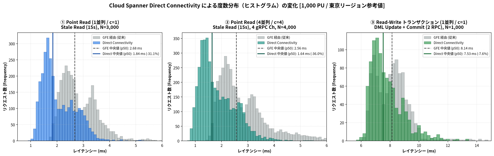
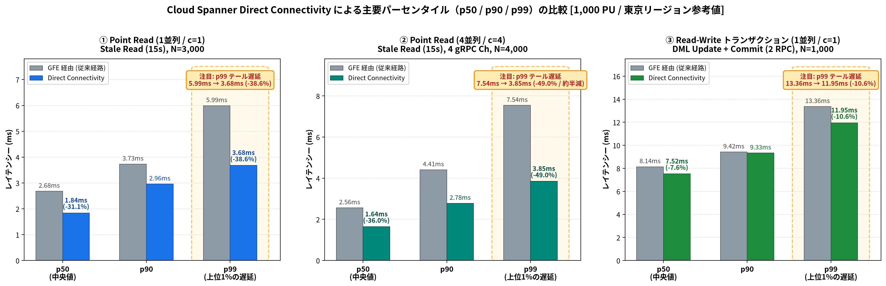
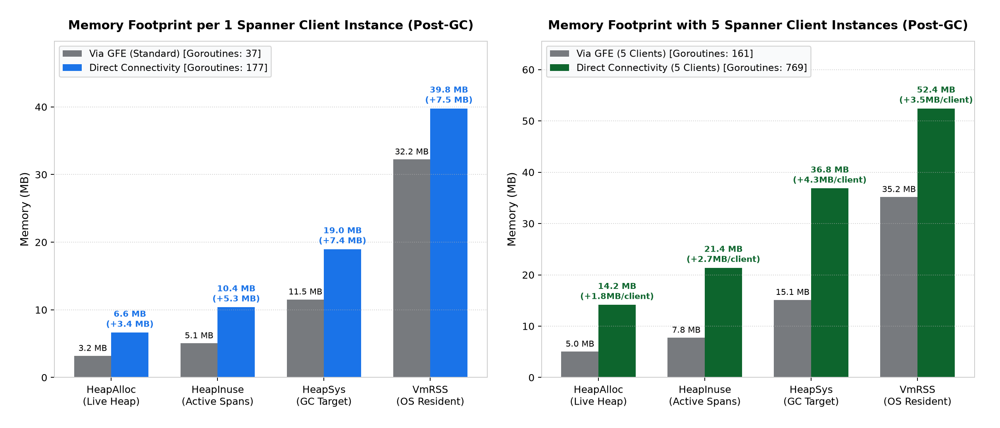

## tl;dr

- Spannerへのアクセスのレイテンシーを短くするための新機能が提供開始されました。
- 2026年9月時点で対応している言語はGoとJavaです。
- メモリの使用量が若干増えるのでご注意ください。

## はじめに

Spannerは分散データベースという特性のため多くのコンポーネントで構成されています。そのため一般的なRDBに比べると単純な処理を行ったときでもレイテンシーが高くなる傾向にありました。レイテンシーの原因の1つはSpannerへのアクセスが **Google Front End（以下、GFE）** を経由することに由来します。これに対し、GFEをバイパスしてクライアントVMからSpannerのAPIフロントエンドへ直接gRPC通信を行う機能が [**Direct Connectivity**](https://docs.cloud.google.com/spanner/docs/latency-points#direct_connectivity) です。

この記事では、Direct Connectivityによって通信経路がどのように変わるのかを説明し、東京リージョンのSpannerインスタンスとGo SDK（[`cloud.google.com/go/spanner`](https://pkg.go.dev/cloud.google.com/go/spanner) v1.95.1）を用いて測定したレイテンシーの変化（度数分布ヒストグラムやパーセンタイル比較）を紹介します。あわせて、利用する上での留意点である「クライアントのメモリ消費量の増加」がなぜ起きるのかを、Goドライバーの実装コードと測定結果から確認します。

> **※注記**：この記事に掲載しているレイテンシーやメモリ消費量の測定値は、あくまで手元の検証環境で試行した際の参考情報であり、実際の環境やワークロードによって数値は異なります。

---

## Direct Connectivityの仕組み

従来の経路（GFE経由）とDirect Connectivityの違いは、**「プロキシ（GFE）のバイパス」** と **「ルーティング解決（コントロールプレーン）のクライアントサイドへの移行」** の2点にあります。

### GFEのバイパス

従来の経路では、クライアントが `spanner.googleapis.com:443` に対して接続すると、[通信はまずGoogle Front End（GFE）に到達します](https://docs.cloud.google.com/spanner/docs/latency-points?hl=ja)。GFEはリクエストを受け取った後、内部の負荷分散・ルート管理基盤と連携して接続先を解決し、対象データベースが配置されているリージョンのSpanner APIフロントエンドへリクエストを中継していました。この構成では、GFEでのプロキシ処理によるオーバーヘッドが毎回のRPCに加算されるほか、GFE層の混雑状況やコネクション再確立に起因するテールレイテンシー（p99〜p99.9）のばらつきが発生する場合がありました。

一方、Direct Connectivityを有効にすると、GCE / GKE上のクライアントはGoogle Cloudの内部ネットワークを介して、Spanner APIフロントエンドへ **GFEを経由せずに直接gRPC通信** を行います。なお、認証・認可やセッション管理、トランザクション処理は引き続きSpanner APIフロントエンド側で行われます。

データ通信（Data Plane）とルート解決（Control Plane）を含めた両者の経路の違いは以下の通りです。

```html-embed
<div class="diagram dc-arch">
  <div class="dc-head">
    <span class="dc-title">Spanner への通信経路：GFE 経由と Direct Connectivity</span>
    <div class="dc-legend">
      <span class="lg-item"><span class="lg-line lg-dc"></span>Direct Connectivity</span>
      <span class="lg-item"><span class="lg-line lg-gfe"></span>GFE 経由（従来）</span>
      <span class="lg-item"><span class="lg-line lg-cp"></span>Control Plane</span>
    </div>
  </div>

  <!-- PC / Tablet Horizontal Topology (width > 560px) -->
  <svg class="svg-pc" viewBox="0 0 640 296" width="100%" role="img" aria-label="Control PlaneとData Planeに分けたGFE経由とDirect Connectivityの通信経路比較（PC表示）">
    <defs>
      <marker id="dc-arr-gray" viewBox="0 0 10 10" refX="8" refY="5" markerWidth="6.5" markerHeight="6.5" orient="auto">
        <path d="M0,1.5 L8.5,5 L0,8.5 Z" fill="var(--muted-line)"/>
      </marker>
      <marker id="dc-arr-blue" viewBox="0 0 10 10" refX="8" refY="5" markerWidth="7" markerHeight="7" orient="auto">
        <path d="M0,1 L9,5 L0,9 Z" fill="var(--primary)"/>
      </marker>
      <marker id="dc-arr-green" viewBox="0 0 10 10" refX="8" refY="5" markerWidth="6" markerHeight="6" orient="auto">
        <path d="M0,1.5 L8.5,5 L0,8.5 Z" fill="var(--green)"/>
      </marker>
    </defs>

    <!-- Control / Data Plane Band & Boundary -->
    <rect x="6" y="6" width="628" height="104" rx="6" fill="var(--cp-band)"/>
    <line x1="10" y1="112" x2="630" y2="112" stroke="var(--border-strong)" stroke-width="1.2" stroke-dasharray="5 4"/>
    <text x="16" y="100" font-size="12" font-weight="700" fill="var(--text-muted)">Control Plane</text>
    <text x="16" y="130" font-size="12" font-weight="700" fill="var(--text-muted)">Data Plane</text>

    <!-- Control Plane Edges: Client (xDS) vs GFE -->
    <line x1="170" y1="208" x2="170" y2="74" stroke="var(--green)" stroke-width="1.8" stroke-dasharray="4 3" marker-end="url(#dc-arr-green)"/>
    <rect x="112" y="83" width="128" height="20" rx="4" fill="var(--green-bg)" stroke="var(--green)" stroke-width="0.8"/>
    <text x="176" y="97" text-anchor="middle" font-size="12" font-weight="700" fill="var(--green)">1. xDS ルート取得</text>

    <line x1="296" y1="43" x2="366" y2="43" stroke="var(--green)" stroke-width="1.5" stroke-dasharray="3 3" marker-end="url(#dc-arr-green)"/>

    <line x1="396" y1="134" x2="396" y2="74" stroke="var(--muted-line)" stroke-width="1.5" stroke-dasharray="3 3" marker-end="url(#dc-arr-gray)"/>
    <text x="406" y="97" font-size="12" fill="var(--text-muted)">従来のルート解決（GFE 側）</text>

    <!-- Data Plane: Legacy GFE 2-hop Path -->
    <path d="M180,226 L234,166" fill="none" stroke="var(--muted-line)" stroke-width="2.2" marker-end="url(#dc-arr-gray)"/>
    <path d="M406,166 L458,226" fill="none" stroke="var(--muted-line)" stroke-width="2.2" marker-end="url(#dc-arr-gray)"/>
    <text x="320" y="212" text-anchor="middle" font-size="12" font-weight="600" fill="var(--text-muted)">従来の経路：GFE 経由（2 ホップ中継）</text>

    <!-- Data Plane: Direct Connectivity 1-hop Highway -->
    <rect x="180" y="242" width="280" height="22" rx="11" fill="var(--primary-glow)"/>
    <line x1="180" y1="253" x2="455" y2="253" stroke="var(--primary)" stroke-width="4" marker-end="url(#dc-arr-blue)"/>
    <rect x="190" y="268" width="260" height="22" rx="5" fill="var(--primary-bg)" stroke="var(--primary)" stroke-width="1"/>
    <text x="320" y="283" text-anchor="middle" font-size="12" font-weight="700" fill="var(--primary)">2. GFE をバイパスして直接通信（1 ホップ）</text>

    <!-- Animated Request Packets (PC) -->
    <circle class="pkt-pc-gfe" cx="0" cy="0" r="5" fill="var(--amber)"/>
    <circle class="pkt-pc-dc" cx="0" cy="0" r="5.5" fill="var(--primary)"/>

    <!-- Nodes (PC) -->
    <rect x="124" y="16" width="172" height="54" rx="8" fill="var(--surface)" stroke="var(--green)" stroke-width="1.6"/>
    <text x="210" y="39" text-anchor="middle" font-size="13" font-weight="700" fill="var(--text)">Traffic Director</text>
    <text x="210" y="57" text-anchor="middle" font-size="12" fill="var(--green)">xDS エンドポイント配信</text>

    <rect x="370" y="16" width="184" height="54" rx="8" fill="var(--surface)" stroke="var(--border-strong)" stroke-width="1.3"/>
    <text x="462" y="39" text-anchor="middle" font-size="13" font-weight="700" fill="var(--text)">内部 LB / ルート管理</text>
    <text x="462" y="57" text-anchor="middle" font-size="12" fill="var(--text-muted)">接続先 IP リスト・負荷分散</text>

    <rect x="238" y="134" width="164" height="58" rx="8" fill="var(--amber-bg)" stroke="var(--amber)" stroke-width="1.6"/>
    <text x="320" y="158" text-anchor="middle" font-size="13" font-weight="700" fill="var(--text)">Google Front End</text>
    <text x="320" y="177" text-anchor="middle" font-size="12" font-weight="600" fill="var(--amber)">プロキシ中継・TLS 終端</text>

    <rect x="14" y="208" width="166" height="76" rx="8" fill="var(--surface)" stroke="var(--primary)" stroke-width="1.8"/>
    <text x="97" y="233" text-anchor="middle" font-size="14" font-weight="700" fill="var(--text)">アプリケーション</text>
    <text x="97" y="252" text-anchor="middle" font-size="12" fill="var(--text-muted)">GCE VM / GKE Pod</text>
    <rect x="35" y="260" width="124" height="18" rx="4" fill="var(--primary-bg)"/>
    <text x="97" y="273" text-anchor="middle" font-size="12" font-weight="700" fill="var(--primary)">Spanner SDK (xDS)</text>

    <rect x="460" y="208" width="166" height="76" rx="8" fill="var(--surface)" stroke="var(--border-strong)" stroke-width="1.8"/>
    <text x="543" y="232" text-anchor="middle" font-size="13" font-weight="700" fill="var(--text)">Spanner API</text>
    <text x="543" y="250" text-anchor="middle" font-size="13" font-weight="700" fill="var(--text)">フロントエンド</text>
    <text x="543" y="270" text-anchor="middle" font-size="12" fill="var(--text-muted)">認証・セッション・Tx 処理</text>
  </svg>

  <!-- Mobile Vertical Topology with Animation (width <= 560px) -->
  <svg class="svg-sp" viewBox="0 0 308 326" width="100%" role="img" aria-label="Control PlaneとData Planeに分けたGFE経由とDirect Connectivityの通信経路比較（モバイル表示）">
    <defs>
      <marker id="sp-arr-gray" viewBox="0 0 10 10" refX="8" refY="5" markerWidth="6" markerHeight="6" orient="auto">
        <path d="M0,1.5 L8.5,5 L0,8.5 Z" fill="var(--muted-line)"/>
      </marker>
      <marker id="sp-arr-blue" viewBox="0 0 10 10" refX="8" refY="5" markerWidth="7" markerHeight="7" orient="auto">
        <path d="M0,1 L9,5 L0,9 Z" fill="var(--primary)"/>
      </marker>
      <marker id="sp-arr-green" viewBox="0 0 10 10" refX="8" refY="5" markerWidth="5.5" markerHeight="5.5" orient="auto">
        <path d="M0,1.5 L8.5,5 L0,8.5 Z" fill="var(--green)"/>
      </marker>
    </defs>

    <!-- Control Plane Right Zone -->
    <rect x="164" y="6" width="138" height="134" rx="6" fill="var(--cp-band)" stroke="var(--border)" stroke-dasharray="4 3"/>
    <text x="233" y="20" text-anchor="middle" font-size="12" font-weight="700" fill="var(--text-muted)">Control Plane</text>

    <!-- Control Plane Connections -->
    <line x1="148" y1="47" x2="170" y2="47" stroke="var(--green)" stroke-width="1.6" stroke-dasharray="3 2" marker-end="url(#sp-arr-green)"/>
    <line x1="233" y1="70" x2="233" y2="86" stroke="var(--green)" stroke-width="1.5" stroke-dasharray="3 2" marker-end="url(#sp-arr-green)"/>
    <line x1="196" y1="168" x2="196" y2="138" stroke="var(--muted-line)" stroke-width="1.5" stroke-dasharray="3 2" marker-end="url(#sp-arr-gray)"/>
    <text x="204" y="158" font-size="12" fill="var(--text-muted)">従来解決</text>

    <!-- Data Plane Left: Direct Connectivity Straight Highway -->
    <rect x="18" y="76" width="20" height="186" rx="10" fill="var(--primary-glow)"/>
    <line x1="28" y1="76" x2="28" y2="257" stroke="var(--primary)" stroke-width="4" marker-end="url(#sp-arr-blue)"/>
    <rect x="42" y="172" width="114" height="42" rx="5" fill="var(--primary-bg)" stroke="var(--primary)" stroke-width="1"/>
    <text x="99" y="190" text-anchor="middle" font-size="12" font-weight="700" fill="var(--primary)">2. Direct 直通</text>
    <text x="99" y="207" text-anchor="middle" font-size="12" font-weight="700" fill="var(--primary)">GFE バイパス</text>

    <!-- Data Plane Right: Legacy GFE 2-hop Detour -->
    <path d="M114,76 L186,166" fill="none" stroke="var(--muted-line)" stroke-width="2" marker-end="url(#sp-arr-gray)"/>
    <path d="M233,220 L233,258" fill="none" stroke="var(--muted-line)" stroke-width="2" marker-end="url(#sp-arr-gray)"/>
    <text x="98" y="128" text-anchor="middle" font-size="12" font-weight="600" fill="var(--text-muted)">従来: 2 ホップ</text>

    <!-- Animated Request Packets (Mobile) -->
    <circle class="pkt-sp-gfe" cx="0" cy="0" r="4.8" fill="var(--amber)"/>
    <circle class="pkt-sp-dc" cx="0" cy="0" r="5.2" fill="var(--primary)"/>

    <!-- Nodes (Mobile) -->
    <rect x="6" y="8" width="142" height="68" rx="8" fill="var(--surface)" stroke="var(--primary)" stroke-width="1.8"/>
    <text x="77" y="29" text-anchor="middle" font-size="13" font-weight="700" fill="var(--text)">アプリケーション</text>
    <text x="77" y="46" text-anchor="middle" font-size="12" fill="var(--text-muted)">GCE / GKE</text>
    <rect x="18" y="52" width="118" height="18" rx="4" fill="var(--primary-bg)"/>
    <text x="77" y="65" text-anchor="middle" font-size="12" font-weight="700" fill="var(--primary)">SDK (xDS)</text>

    <rect x="173" y="25" width="120" height="45" rx="7" fill="var(--surface)" stroke="var(--green)" stroke-width="1.5"/>
    <text x="233" y="44" text-anchor="middle" font-size="12" font-weight="700" fill="var(--text)">Traffic Director</text>
    <text x="233" y="61" text-anchor="middle" font-size="12" font-weight="700" fill="var(--green)">1. xDS 取得</text>

    <rect x="173" y="89" width="120" height="45" rx="7" fill="var(--surface)" stroke="var(--border-strong)" stroke-width="1.2"/>
    <text x="233" y="108" text-anchor="middle" font-size="12" font-weight="700" fill="var(--text)">内部 LB / ルート</text>
    <text x="233" y="125" text-anchor="middle" font-size="12" fill="var(--text-muted)">接続先 IP 管理</text>

    <rect x="166" y="168" width="134" height="52" rx="8" fill="var(--amber-bg)" stroke="var(--amber)" stroke-width="1.5"/>
    <text x="233" y="190" text-anchor="middle" font-size="12" font-weight="700" fill="var(--text)">Google Front End</text>
    <text x="233" y="208" text-anchor="middle" font-size="12" font-weight="600" fill="var(--amber)">プロキシ中継</text>

    <rect x="6" y="262" width="296" height="56" rx="8" fill="var(--surface)" stroke="var(--border-strong)" stroke-width="1.8"/>
    <text x="154" y="286" text-anchor="middle" font-size="13" font-weight="700" fill="var(--text)">Spanner API フロントエンド</text>
    <text x="154" y="306" text-anchor="middle" font-size="12" fill="var(--text-muted)">認証・セッション・トランザクション処理</text>
  </svg>
</div>

<style>
  .dc-arch {
    --bg: #f8fafc; --surface: #ffffff; --cp-band: #f1f5f9;
    --text: #0f172a; --text-muted: #475569;
    --border: #cbd5e1; --border-strong: #64748b; --muted-line: #64748b;
    --primary: #0b66ef; --primary-bg: #e0f2fe; --primary-glow: rgba(11, 102, 239, 0.10);
    --green: #0d9488; --green-bg: #ccfbf1;
    --amber: #b45309; --amber-bg: #fef3c7;
    box-sizing: border-box; padding: 14px 16px; background: var(--bg); color: var(--text);
    border: 1px solid var(--border); border-radius: 10px;
    font-family: -apple-system, BlinkMacSystemFont, "Hiragino Sans", "Noto Sans JP", sans-serif;
    font-size: 13px; line-height: 1.4;
  }
  [data-theme="dark"] .dc-arch {
    --bg: #0f172a; --surface: #1e293b; --cp-band: #162032;
    --text: #f1f5f9; --text-muted: #94a3b8;
    --border: #334155; --border-strong: #94a3b8; --muted-line: #94a3b8;
    --primary: #38bdf8; --primary-bg: #0c4a6e; --primary-glow: rgba(56, 189, 248, 0.14);
    --green: #2dd4bf; --green-bg: #115e59;
    --amber: #fbbf24; --amber-bg: #451a03;
  }
  .dc-arch *, .dc-arch *::before, .dc-arch *::after { box-sizing: border-box; }
  .dc-arch .dc-head {
    display: flex; align-items: center; justify-content: space-between; flex-wrap: wrap; gap: 8px;
    margin-bottom: 8px; padding-bottom: 8px; border-bottom: 1px solid var(--border);
  }
  .dc-arch .dc-title { font-weight: 700; font-size: 13px; }
  .dc-arch .dc-legend { display: flex; align-items: center; gap: 12px; flex-wrap: wrap; font-size: 12px; color: var(--text-muted); }
  .dc-arch .lg-item { display: inline-flex; align-items: center; gap: 5px; }
  .dc-arch .lg-line { display: inline-block; width: 18px; height: 0; }
  .dc-arch .lg-dc { border-top: 3px solid var(--primary); }
  .dc-arch .lg-gfe { border-top: 2px solid var(--muted-line); }
  .dc-arch .lg-cp { border-top: 2px dashed var(--green); }
  .dc-arch .svg-sp { display: none; }

  @keyframes dc-pc-gfe {
    0%   { transform: translate(180px, 226px); opacity: 0; }
    8%   { transform: translate(180px, 226px); opacity: 1; }
    38%  { transform: translate(238px, 166px); opacity: 1; }
    62%  { transform: translate(402px, 166px); opacity: 1; }
    92%  { transform: translate(458px, 226px); opacity: 1; }
    100% { transform: translate(458px, 226px); opacity: 0; }
  }
  @keyframes dc-pc-direct {
    0%   { transform: translate(182px, 253px); opacity: 0; }
    10%  { transform: translate(182px, 253px); opacity: 1; }
    85%  { transform: translate(452px, 253px); opacity: 1; }
    100% { transform: translate(452px, 253px); opacity: 0; }
  }
  @keyframes dc-sp-gfe {
    0%   { transform: translate(114px, 76px); opacity: 0; }
    8%   { transform: translate(114px, 76px); opacity: 1; }
    42%  { transform: translate(190px, 170px); opacity: 1; }
    66%  { transform: translate(233px, 220px); opacity: 1; }
    92%  { transform: translate(233px, 258px); opacity: 1; }
    100% { transform: translate(233px, 258px); opacity: 0; }
  }
  @keyframes dc-sp-direct {
    0%   { transform: translate(28px, 78px); opacity: 0; }
    10%  { transform: translate(28px, 78px); opacity: 1; }
    85%  { transform: translate(28px, 254px); opacity: 1; }
    100% { transform: translate(28px, 254px); opacity: 0; }
  }
  .dc-arch .pkt-pc-gfe { animation: dc-pc-gfe 3.4s ease-in-out infinite; }
  .dc-arch .pkt-pc-dc  { animation: dc-pc-direct 1.6s linear infinite; }
  .dc-arch .pkt-sp-gfe { animation: dc-sp-gfe 3.4s ease-in-out infinite; }
  .dc-arch .pkt-sp-dc  { animation: dc-sp-direct 1.6s linear infinite; }

  @media (max-width: 560px) {
    .dc-arch { padding: 10px 12px; }
    .dc-arch .dc-head { gap: 4px; margin-bottom: 6px; padding-bottom: 6px; }
    .dc-arch .dc-legend { gap: 8px; }
    .dc-arch .svg-pc { display: none; }
    .dc-arch .svg-sp { display: block; }
  }
  @media (prefers-reduced-motion: reduce) {
    .dc-arch *, .dc-arch *::before, .dc-arch *::after { animation: none !important; transition: none !important; }
    .dc-arch .pkt-pc-gfe, .dc-arch .pkt-pc-dc, .dc-arch .pkt-sp-gfe, .dc-arch .pkt-sp-dc { display: none; }
  }
</style>
```

### ルート解決とdp_checkによる事前確認

従来はGFE側で行っていた「どのエンドポイント（IPアドレス）にリクエストを送るべきか」のルート解決を、GFEをバイパスするDirect Connectivityではクライアント側で行う必要があります。具体的には、Google Cloudの **Traffic Director**（xDSプロトコル）を介して接続先のエンドポイントリストやルーティング情報を事前に取得することで、[クライアント側のRPCライブラリが適切なSpanner APIフロントエンドへ直接リクエストを振り分ける](https://pkg.go.dev/google.golang.org/grpc/xds)仕組みになっています。

稼働中のGCE VMやGKE Podのネットワーク環境（VPCルート、ファイアウォール、サービスアカウント権限など）においてDirect Connectivityが利用可能かどうかは、Google Cloudが公開している診断ツール **`dp_check`**（[`GoogleCloudPlatform/grpc-gcp-tools`](https://github.com/GoogleCloudPlatform/grpc-gcp-tools)）を実行することで事前に判別できます。

```bash
# GCE VM / GKE Pod 上での Direct Connectivity 疎通確認コマンド
curl -sL https://github.com/GoogleCloudPlatform/grpc-gcp-tools/releases/latest/download/dp_check -o dp_check
chmod +x dp_check
./dp_check --service=spanner.googleapis.com
```

要件を満たしていれば、以下のように各項目のチェックが `PASSED` と出力されます。

```text
Running on GCP: PASSED
IPv4 address allocated to VM's primary NIC: PASSED
Xds bootstrap environment variable: PASSED
...
Secure connectivity to IPv4 backends from Traffic Director: PASSED
```

---

## 実測検証

Direct Connectivityの効果を確認するため、東京リージョンの1,000 Processing Units（1 Node）インスタンスに対してベンチマークを実施しました。

### 測定環境とワークロード仕様

- クライアント環境：Compute Engine `n4-standard-2`（2 vCPU, 8 GB RAM, 東京 `asia-northeast1-b`）
- Spanner環境：`regional-asia-northeast1` 構成、1,000 Processing Units（1 Node）
- ソフトウェア：Go 1.26.0、`cloud.google.com/go/spanner` v1.95.1、`google.golang.org/grpc` v1.82.1
- 対象テーブル：主キー `id INT64` と `name STRING(MAX)` のみを持つシンプルな `PoC_Users` テーブル（セカンダリインデックスなし、100行投入済み）
- 比較条件：
  1. **GFE経由（従来経路）**：`GOOGLE_SPANNER_ENABLE_DIRECT_ACCESS=false`
  2. **Direct Connectivity**：`GOOGLE_SPANNER_ENABLE_DIRECT_ACCESS=true`
- 測定ワークロード：
  - Point Read (`Concurrency = 1`, 3,000 samples)：実運用において単一行の参照（Point Read）を行う際は、高速に読み取るためStale Readを用いるのが一般的です。そこで本計測では `client.Single().WithTimestampBound(spanner.ExactStaleness(15 * time.Second)).ReadRow` による1行読み取り（1リクエスト＝1 RPC往復）を実施しました。
  - Point Read (`Concurrency = 4`, 4,000 samples)：4 goroutineから同時にStale Read（`ExactStaleness=15s`）を実行（デフォルトの4本のgRPCチャネルを並行利用）。
  - Read-Write Transaction DML (`Concurrency = 1`, 1,000 samples)：`client.ReadWriteTransaction` 内で `UPDATE PoC_Users SET name = @name WHERE id = @id` を実行。Go SDKの `InlineBegin` 最適化により、トランザクション開始は最初の `ExecuteSql` に含まれるため、1トランザクション＝2 RPC往復（`ExecuteSql` + `Commit`）となります。

### 実測結果サマリ

測定結果は以下の通りです（単位：ミリ秒）。

| ワークロード | 接続経路 | Mean (平均) | StdDev (標準偏差) | Min (最小) | p50 (中央値) | p90 | p95 | p99 | p99.9 |
| :--- | :--- | :---: | :---: | :---: | :---: | :---: | :---: | :---: | :---: |
| **Point Read (c=1)**<br>*(Stale Read 15s, 1 RPC)* | GFE 経由 (従来) | 2.88 ms | 0.80 ms | 1.70 ms | 2.68 ms | 3.73 ms | 4.12 ms | 5.99 ms | 8.33 ms |
| | **Direct Connectivity** | 2.06 ms** | 0.79 ms | 0.98 ms** | 1.84 ms | 2.96 ms | 3.16 ms | 3.68 ms** | 5.13 ms |
| | *短縮効果 (差分 / 割合)* | -0.82 ms (-28%) | -0.01 ms | -0.72 ms (-42%) | **-0.83 ms (-31%)** | -0.77 ms (-21%) | -0.96 ms (-23%) | **-2.31 ms (-39%)** | -3.20 ms (-38%) |
| **Point Read (c=4)**<br>*(Stale Read 15s, 4 Ch)* | GFE 経由 (従来) | 2.93 ms | 1.20 ms | 1.47 ms | 2.56 ms | 4.41 ms | 5.29 ms | 7.54 ms | 10.39 ms |
| | **Direct Connectivity** | 1.84 ms | 0.69 ms | 0.80 ms | 1.64 ms | 2.78 ms | 3.04 ms | 3.85 ms | 5.43 ms |
| | *短縮効果 (差分 / 割合)* | -1.09 ms (-37%) | -0.51 ms (-43%) | -0.67 ms (-46%) | **-0.92 ms (-36%)** | -1.63 ms (-37%) | -2.25 ms (-43%) | **-3.69 ms (-49%)** | -4.96 ms (-48%) |
| **Read-Write Txn (c=1)**<br>*(2 RPCs: Update+Commit)* | GFE 経由 (従来) | 8.15 ms | 1.29 ms | 6.04 ms | 8.14 ms | 9.42 ms | 9.80 ms | 13.36 ms | 17.16 ms |
| | **Direct Connectivity** | 7.84 ms | 1.34 ms | 5.86 ms | 7.52 ms | 9.33 ms | 10.19 ms | 11.95 ms | 17.70 ms |
| | *短縮効果 (差分 / 割合)* | -0.31 ms (-4%) | +0.05 ms | -0.18 ms | **-0.62 ms (-8%)** | -0.09 ms | +0.39 ms | **-1.41 ms (-11%)** | +0.54 ms |

### 結果の比較

測定した3つのパターンについて、レイテンシーごとのリクエスト件数を表す**度数分布（ヒストグラム）**と、中央値や上位1%の遅延を表す**主要パーセンタイル（p50 / p90 / p99）の棒グラフ**を示します。





ヒストグラムを見ると、3パターンともDirect Connectivityでは分布全体がそのまま左（低レイテンシー側）へ0.8〜1.0 msほどシフトしています。

また、パーセンタイルの棒グラフ（黄色破線枠の `p99`）を見ると、中央値だけでなく上位1%のテールレイテンシーの跳ね上がりが大きく抑えられていることがわかります。とくに4並列（c=4）のPoint ReadではGFE経由のp99が `7.54 ms` まで伸びていたのに対し、Direct Connectivityでは `3.85 ms` と約半分に収まっています。

---

## クライアントのメモリ消費量について

Direct Connectivityを有効にすると、クライアント側でエンドポイント情報の管理やフォールバック用の通信経路を保持するため、メモリ消費量がわずかに増加します。ここではGo SDK（`cloud.google.com/go/spanner` v1.95.1）の実装コードと、手元の検証環境で測定した参考値から、メモリ消費が増加する仕組みを確認します。

### メモリ消費量が増える理由

#### フォールバック用コネクションプールの保持

主要なメモリ使用量増加の要因は、Direct Connectivityの経路に万が一問題が生じた際、リクエストを失敗させずに従来のGFE経由へ即座に切り替えられるよう、クライアント内部でフォールバック用のコネクションプールもあわせて保持する実装になっていることです。

実際にGo SDK（`cloud.google.com/go/spanner` v1.95.1）の [`spanner/client.go` 内の `createFallbackConnPool` 関数（L596-L645）](https://github.com/googleapis/google-cloud-go/blob/spanner/v1.95.1/spanner/client.go#L596-L645) を確認すると、以下のように実装されています。

```go
// 参照元: https://github.com/googleapis/google-cloud-go/blob/spanner/v1.95.1/spanner/client.go#L596-L645
// パッケージ・バージョン: cloud.google.com/go/spanner v1.95.1
func createFallbackConnPool(
	ctx context.Context,
	config ClientConfig,
	hasNumChannelsConfig bool,
	metricsTracerFactory *builtinMetricsTracerFactory,
	opts ...option.ClientOption,
) (gtransport.ConnPool, []option.ClientOption, error) {
	...
	allOpts := allClientOpts(config.NumChannels, config.Compression, config.EnableDirectAccess, opts...)
	// 1. Direct Connectivity 用のプライマリコネクションプールを作成 (デフォルト 4 チャネル)
	primaryConn, err := gtransport.DialPool(ctx, allOpts...)
	if err != nil {
		return nil, nil, err
	}

	// 2. 通信障害時に即座に GFE 経由へ退避するためのフォールバックプールを作成 (4 チャネル)
	fallbackConnOpts := append(allOpts, internaloption.EnableDirectPath(false))
	fallbackConn, err := gtransport.DialPool(ctx, fallbackConnOpts...)
	if err != nil {
		primaryConn.Close()
		return nil, nil, err
	}
	...
	// 3. 2 つのプールをラップし、エラー発生時の自動フォールバックを構成
	gcpFallback, err := grpcgcp.NewGCPFallback(ctx, primaryConn, fallbackConn, fbOpts)
	...
	return &fallbackWrapper{gcpFallback, primaryConn, fallbackConn}, allOpts, nil
}
```

Spanner Goクライアントはデフォルトで `NumChannels = 4` 本のgRPCチャネルを作成します。Direct Connectivity有効時は、`primaryConn`（直接通信用の4チャネル）に加えて、退避用の `fallbackConn`（GFE経由の4チャネル）が同時に初期化・維持されるため、1つの `spanner.Client` インスタンス内で保持されるチャネル構造体が2倍（計8チャネル分）になります。

#### エンドポイント管理（xDS）とGoランタイムのヒープ予約

フォールバックプールの保持に加え、従来GFE側で行っていた接続先エンドポイントリストの管理やヘルスチェック（xDSクライアントおよびルートキャッシュ）をクライアントプロセスのメモリ上で処理するため、生存ヒープ（`HeapAlloc`）が数MB増加します。また、これに伴い通信やヘルスチェックを管理するバックグラウンドのgoroutineも追加で動作します（ただし、一般的なWebアプリケーション等では元々多くのgoroutineが動作するため、Direct Connectivityに関連するgoroutineの増加分はアプリケーション全体から見れば相対的にわずかです）。

また、Goのランタイム（デフォルトの `GOGC=100`）は生存ヒープの約2倍のメモリ空間を予約する特性があります。そのため、xDSキャッシュやフォールバックプールによって生存ヒープ（`HeapAlloc`）が約3.4 MB増加すると、GoランタイムがOSから確保する物理メモリ（`VmRSS`：Resident Set Size）としてはその約2倍にあたる **約7.5〜9.2 MBの増加** となって現れます。

### 実機でのメモリ消費量計測結果

GCE VM上で `spanner.Client` インスタンスを1個作成した場合と、複数のデータベースへ接続するケースを想定して5個作成した場合のそれぞれについて、Warmup完了後に `runtime.GC()` を実行した状態（Post-GC）のメモリ統計（`runtime.ReadMemStats` およびLinux `/proc/self/status` の `VmRSS`）を計測しました。



| クライアント数 | 接続経路 | Goroutines<br>(`NumGoroutine`) | HeapAlloc<br>*(生存ヒープ)* | HeapInuse<br>*(使用中スパン)* | HeapSys<br>*(GC Target / 予約済)* | VmRSS (Post-GC)<br>*(OS 実メモリ消費)* | VmRSS (Pre-GC)<br>*(GC 前ピーク RSS)* |
| :--- | :--- | :---: | :---: | :---: | :---: | :---: | :---: |
| **0 (Baseline)** | 起動直後・接続前 | 6 | 2.63 MB | 4.49 MB | 11.66 MB | 31.49 MB | — |
| **1 Client**<br>*(標準構成)* | GFE 経由 (従来) | 37 | 3.19 MB | 5.05 MB | 11.53 MB | 32.23 MB | 33.45 MB |
| | **Direct Connectivity** | 177 | 6.63 MB | 10.38 MB | 18.97 MB | 39.77 MB | 42.64 MB |
| | *1 Client あたりの増分* | +140 goroutines | **+3.44 MB** | +5.33 MB | +7.44 MB | **+7.54 MB** | **+9.19 MB** |
| **5 Clients**<br>*(複数 DB 接続)* | GFE 経由 (従来) | 161 | 5.04 MB | 7.75 MB | 15.13 MB | 35.17 MB | 37.67 MB |
| | **Direct Connectivity** | 769 | 14.15 MB | 21.38 MB | 36.84 MB | 52.43 MB | 60.06 MB |
| | *5 Clients 合計の増分* | +608 goroutines | +9.11 MB | +13.63 MB | +21.71 MB | +17.26 MB | +22.39 MB |
| | *1 Client あたりの平均増分* | +121.6 / client | **+1.82 MB / client** | +2.73 MB / client | +4.34 MB / client | **+3.45 MB / client** | **+4.48 MB / client** |

5クライアント作成時に1クライアントあたりの増分が小さくなっているのは、`grpc-go` のxDSクライアント実装やTraffic Directorとの通信キャッシュの一部がプロセス内で共有されるためです。

通常のGCE VMやGKE Podであれば10 MB前後のメモリ増加が問題になることは少ないですが、リクエストごとに `spanner.NewClient` を作り直すような実装をしている場合や、コンテナのメモリ上限を128〜256 MB程度に切り詰めている環境では注意が必要です。原則通り `spanner.Client` はアプリケーション起動時に1度だけ初期化して使い回し、コンテナのメモリ上限には15〜20 MBほどの余裕を持たせておくと安全です。

---

## 有効化の手順と前提条件

### 前提条件

- **実行環境**：クライアントがGoogle Compute Engine（GCE）またはGoogle Kubernetes Engine（GKE）上で稼働していること（Cloud Runなどの環境からはDirect Connectivityの直接経路は利用できず、自動的にGFE経由の通信へフォールバックします）。
- **同一リージョン配置（推奨）**：クライアントVM / PodとSpannerインスタンスが同一リージョン（例：ともに `asia-northeast1`）に配置されていること。
- **SDKバージョン**（[公式ドキュメント記載の要件](https://docs.cloud.google.com/spanner/docs/latency-points#direct_connectivity)）：
  - Go：`cloud.google.com/go/spanner` v1.88.0以降
  - Java：`google-cloud-spanner` v6.111.0以降
- **ネットワーク・ファイアウォール要件**：VPCのルートおよび下り（Egress）ファイアウォールルールにて、Direct Connectivity用のエンドポイントIP範囲である `34.126.0.0/18`（IPv4）および `2001:4860:8040::/42`（IPv6）へのTCP通信が許可されていること。
- **IAM権限**：クライアントのサービスアカウントに `spanner.databases.get` 権限が付与されていること（データベース単位のルーティングメタデータ取得に必要です）。

### 設定方法

アプリケーションコードを変更することなく、環境変数を1つ設定してプロセスを再起動するだけで有効化できます。

```bash
# 環境変数による Direct Connectivity の有効化（Go / Java 共通）
export GOOGLE_SPANNER_ENABLE_DIRECT_ACCESS=true
```

Goのコード内で明示的に制御したい場合は、`spanner.ClientConfig` の `EnableDirectAccess` フィールドに `true` を指定します。

```go
cfg := spanner.ClientConfig{
    EnableDirectAccess: true,
    NumChannels:        4,
}
client, err := spanner.NewClientWithConfig(ctx, databaseName, cfg)
```

### Cloud Monitoringでのメトリクス確認

Cloud Monitoringへ送信されるクライアントサイドメトリクス（`spanner.googleapis.com/client/operation_latencies` など）において、ラベルとして付与される `directpath_enabled`（設定が有効か）および `directpath_used`（実際にリクエストがDirect Connectivity経路で処理されたか）をフィルタリングすることで、直接通信が利用されているかどうかやレイテンシーの改善幅をCloud Monitoring上で確認できます。

---

## まとめ

Direct Connectivityは、環境変数 `GOOGLE_SPANNER_ENABLE_DIRECT_ACCESS=true` を設定するだけでGFEプロキシのオーバーヘッドをバイパスし、Spannerへのアクセスレイテンシー（とくにp99のテールレイテンシー）を下げられる機能です。

クライアント側でフォールバック用チャネルやxDSのルート情報を保持する分だけ1クライアントあたり10 MB弱のメモリ増加を伴いますが、GCE / GKE上でGo・Javaアプリケーションを運用している場合は手軽に試せる改善策になります。
