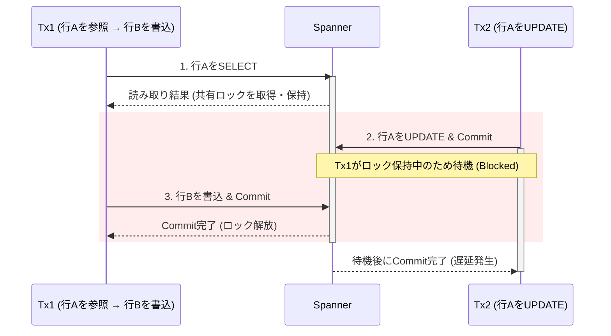
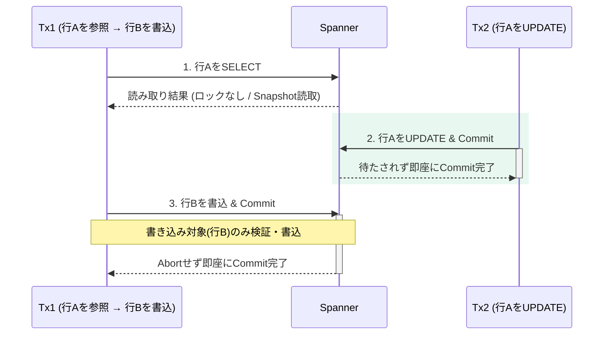
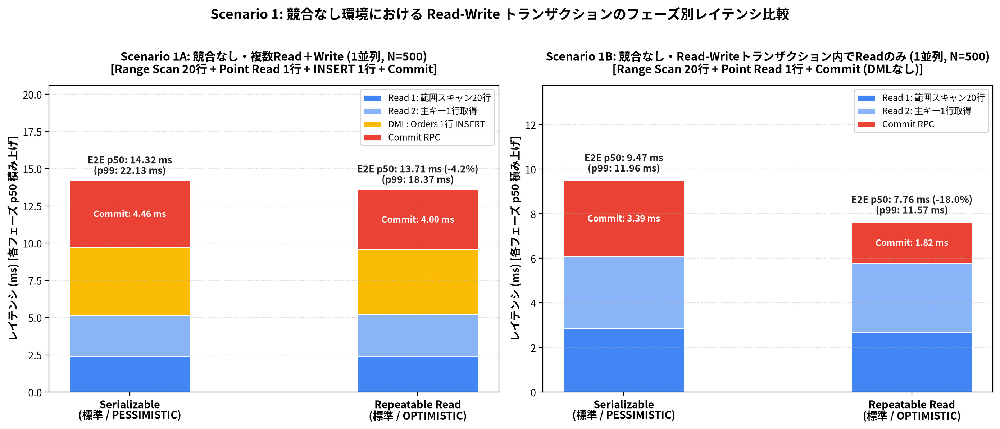
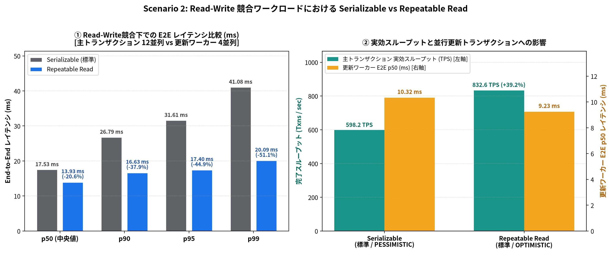
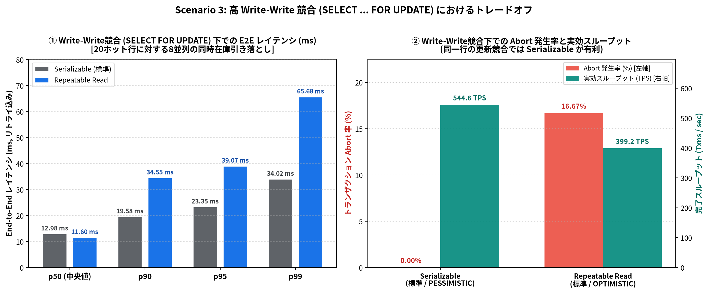
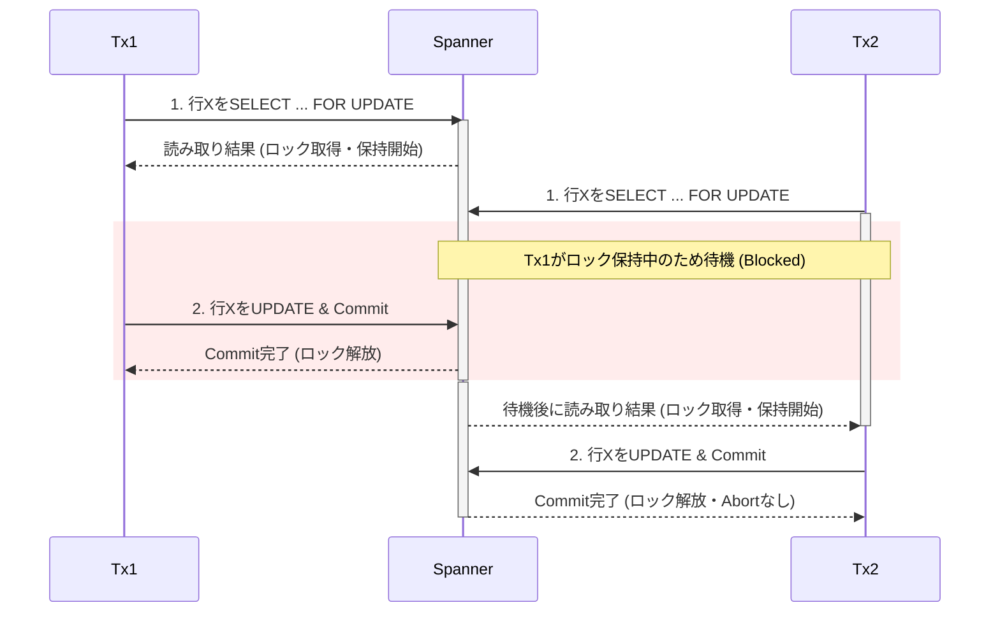

## tl;dr

- Spannerの`Repeatable Read`は、MySQLなどの一般的なRDBからの移行を容易にするだけでなく、同じデータへの参照と更新が重なる（Read-Write競合）トランザクションのレイテンシを短縮する効果があります。
- 特に多くの参照と一部の更新が混在するワークロードでは、読み取り時のロック待ちがなくなることでテールレイテンシ（p99）が半減し、並行する更新トランザクションのCommitも高速化されます。
- 新規アプリケーションではデータ整合性が最も高い標準の`Serializable`を基本としつつ、Read-Write競合がボトルネックとなるトランザクションに絞って`Repeatable Read`へオプトインする使い分けが推奨されます。

## はじめに

Spannerは長らく、Read-Writeトランザクションの分離レベルとして最も厳格な`Serializable`のみを提供してきました。その後、新たに[Repeatable Read](https://docs.cloud.google.com/spanner/docs/isolation-levels)分離レベルに対応しました[1]。

この`Repeatable Read`は、MySQLやPostgreSQLなどの一般的なリレーショナルデータベース（以下、RDB）で構築された既存のアプリケーションを、更新時のロジックを変えずにSpannerへ移行するための機能として紹介されることが多いと感じています。

一方で、MySQLやPostgreSQLの標準構成では通常の`SELECT`がロックを取らないのに対し、Spannerの標準である`Serializable`では通常の`SELECT`でも共有ロックを取得します。そのため、同じ行に対する参照と更新が重なる（Read-Write競合）と双方でロック待ちが発生しやすくなります。ここで内部の並行性制御の仕組みに目を向けると、`Repeatable Read`は「移行時の互換性確保」だけでなくパフォーマンス改善の選択肢にもなります。

本稿では、一般的なRDBの挙動と比べながらSpannerにおける`Serializable`と`Repeatable Read`の内部の並行性制御の違いを整理し、Go SDKを用いた実測ベンチマークをもとに、自身のワークロードでどちらの分離レベルを選ぶべきか判断できる状態を目指します。

※本稿に掲載しているレイテンシやスループットの測定値は、手元の検証環境で試行した際の参考情報であり、実際の環境やワークロードによって数値は異なります。

## SerializableとRepeatable Readの仕組みの違い

実測結果を見る前に、Spannerにおける`Serializable`と`Repeatable Read`の制御方式の違いを整理します。

Spannerのデフォルト設定では、`Serializable`は悲観的並行性制御（PCC、`ReadLockMode`は`PESSIMISTIC`）、`Repeatable Read`は楽観的並行性制御（OCC、同`OPTIMISTIC`）で動作します[2]。まずはこの標準設定同士を比較し、設定で変更できる標準以外の組み合わせについては後半の補足で扱います。

### カフェの利用で考えるPCCとOCC

データベースの並行性制御には、PCCとOCCという対照的な2つのアプローチがあります。

この2つの違いを直感的にイメージするため、一般的なカフェを利用する場面を想定してみます。カフェでは、空いている時間帯は先に注文してから席を探しますが、混雑時には店員さんから「お席の確保を先にお願いします」とアナウンスされていることが多いと思います。どちらが最適な戦略になるかは混雑状況によります。これは後半の検証内容とも関係します。

#### PCC（悲観的並行性制御）の場合

先に席を確保してから、商品を受け取って席につくイメージです。レジに並んだり商品を受け取ったりしている間もずっと席を押さえているため、1人が席を取っている時間が長くなり、店全体として席が埋まっている時間が相対的に長くなります。一方で、商品を受け取ったあとに席を探し回る必要がなく、確実に席に座ることができます。

#### OCC（楽観的並行性制御）の場合

先に商品を受け取ってから、空いている席を探して着席するイメージです。注文して受け取るまでの間は席を押さえないため、1人が席を取っている時間が短くなり、店の運営全体としては回転が良くスムーズに回ります。一方で、店内が混雑してくると、トレイを持ったまま座席を探し回る必要が出てきます。最悪の場合には席が見つからず立って待つ可能性もあります。


### Spanner内部でのロックと検証の動作

上記のPCCとOCCの違いを踏まえて、Spannerが`Serializable`と`Repeatable Read`で実際にどのような制御を行っているのかを見てみます。

マニュアルには、Spannerの`Repeatable Read`について以下のような説明がされています[1]。

> In Spanner, repeatable read isolation is implemented using a technique commonly known as snapshot isolation. Repeatable read isolation in Spanner ensures that all read operations within a transaction see a consistent, or strong, snapshot of the database as it existed at the start of the transaction. It also guarantees that concurrent writes on the same data only succeed if there are no conflicts.

トランザクション内の通常の`SELECT`クエリー（`FOR UPDATE`を付けない読み取り）は、ロックを一切取得せず、最初の読み取り時点のスナップショットを読むだけで完結するイメージです[5]。

※以降の図解では分かりやすく行単位で表現します。

| フェーズ | Serializable（標準 / `PESSIMISTIC`） | Repeatable Read（標準 / `OPTIMISTIC`） |
| :--- | :--- | :--- |
| 1. 通常の`SELECT`実行時 | 対象範囲に共有ロック（`ReaderShared`）を取得する。他トランザクションの排他系ロックと競合した場合は待機するか、デッドロック回避のため片方がAbortされる[2][5]。 | ロックを取得しない。最初の読み取り時点で確定したスナップショットから読み取る[2]。 |
| 2. トランザクション実行中（DML含む） | 読み取りで取得した共有ロックをCommitまで保持する。DML実行時もスキャン範囲の共有ロックや変更対象の排他ロックを取得する[2][5]。 | 通常の読み取りもDMLも実行フェーズではロックを取得せず、他の更新とブロックし合わない[1][2]。 |
| 3. `Commit`実行時 | 保持中の共有ロックが有効か確認し、書き込み対象の排他ロックを取得してCommitする[2][5]。 | 書き込み対象に排他ロックを取得した上で、書き込み対象や`SELECT ... FOR UPDATE`で読み取った範囲などが自分の読み取り以降に変更されていないかを検証してCommitする[1][2][5]。 |

まず、実務で問題になりやすいRead-Write競合について、具体的な動作をシーケンス図で確認します。

ここでは、「`Tx1`が商品マスタ（行A）を通常の`SELECT`で参照したあと、注文テーブル（別行B）に書き込む」最中に、「裏で`Tx2`が同じ商品マスタ（行A）を`UPDATE`する」場合の動きを比べます。

#### Serializable（標準 / `PESSIMISTIC`）の場合

`Tx1`が更新しない行Aであっても、通常の`SELECT`を実行した時点で共有ロック（`ReaderShared`）を取得し、`Commit`完了まで保持し続けます。そのため、並行して実行された`Tx2`の更新はロック解放までブロックされます。



#### Repeatable Read（標準 / `OPTIMISTIC`）の場合

`Tx1`の通常の`SELECT`はロックを取らず、さらに参照しただけの行Aは`Commit`時の変更検証対象にも含まれません（表のフェーズ3参照）。そのため、参照したマスタ行が裏で`Tx2`によって頻繁に更新されていても、ロック待ちも`Commit`時のAbortも発生せず、互いに干渉することなく並列に処理を完了できます。



## 実測検証

この仕組みの違いによって、実際のアプリケーションが体感するレイテンシがどれぐらい変わるのかを確認するため、3つの異なるワークロードでベンチマークを実施しました。

### 準備

測定環境の構成は以下の通りです。ネットワーク経路の揺らぎを最小化するため、同一ゾーンのCompute Engine VMからDirect Connectivityを有効にして接続しています。

* クライアント環境：Compute Engine `n4-standard-2`（2 vCPU, 8 GB RAM, `asia-northeast1-b`）
* Spanner環境：`regional-asia-northeast1`（東京リージョン）、1,000 Processing Units（1 Node, Enterprise Edition）
* 通信経路：Direct Connectivity有効（`GOOGLE_SPANNER_ENABLE_DIRECT_ACCESS=true`）[8]
* ソフトウェア：Go 1.26.6、`cloud.google.com/go/spanner` v1.95.1（4 gRPC Channels）[9]

検証用のスキーマとして、ECサイトの商品マスタと注文テーブルを模した以下の2つのテーブル（`Products`および`Orders`）を作成し、10カテゴリ×各100商品（計1,000行）の初期データを投入しました。

```sql
CREATE TABLE Products (
  category_id INT64 NOT NULL,
  product_id INT64 NOT NULL,
  name STRING(128) NOT NULL,
  stock INT64 NOT NULL,
  sales_count INT64 NOT NULL,
  updated_at TIMESTAMP NOT NULL OPTIONS (allow_commit_timestamp=true),
) PRIMARY KEY (category_id, product_id);

CREATE TABLE Orders (
  order_id STRING(64) NOT NULL,
  category_id INT64 NOT NULL,
  product_id INT64 NOT NULL,
  quantity INT64 NOT NULL,
  total_stock_snapshot INT64 NOT NULL,
  created_at TIMESTAMP NOT NULL OPTIONS (allow_commit_timestamp=true),
) PRIMARY KEY (order_id);
```

Go SDKでは、`ReadWriteTransactionWithOptions`に`TransactionOptions`を渡すことで、同じ`spanner.Client`を使いながらトランザクションごとに分離レベルを切り替えられます。

```go
// Serializable（標準設定）で実行する場合
optsSerializable := spanner.TransactionOptions{
    IsolationLevel: sppb.TransactionOptions_SERIALIZABLE,
}

// Repeatable Read（標準設定）で実行する場合
optsRepeatableRead := spanner.TransactionOptions{
    IsolationLevel: sppb.TransactionOptions_REPEATABLE_READ,
}

_, err := client.ReadWriteTransactionWithOptions(ctx, func(ctx context.Context, txn *spanner.ReadWriteTransaction) error {
    // トランザクション処理
    return nil
}, optsRepeatableRead)
```

`TransactionOptions`内の`ReadLockMode`フィールドを省略すると、各分離レベルの標準ロックモードが自動選択されます[2][3]。`Serializable`では`PESSIMISTIC`、`Repeatable Read`では`OPTIMISTIC`が適用されます。

### 実行

以下の3つのシナリオで、`Serializable`と`Repeatable Read`のEnd-to-End（以下、E2E）レイテンシ、各フェーズの内訳、およびAbort発生率を比較しました。あわせて、Spannerの組み込み統計ビューである`SPANNER_SYS`を用いてサーバー側の内部統計も確認しています。

1. Scenario 1（競合なし・1並列）：他のトランザクションが一切動いていない状態で、500トランザクションを直列実行し、純粋なオーバーヘッドの差を測定する。
2. Scenario 2（Read-Write競合・12並列＋4並列）：共通の`Products`テーブルに対して、裏で更新トランザクション（4並列）が動く中で参照＋`Orders`への追記（12並列）を行う。
3. Scenario 3（高Write-Write競合・8並列）：20行のホットな`Products`レコードに対して、8並列で同時に`SELECT ... FOR UPDATE`と`UPDATE`を実行する。

### Scenario 1：競合なし環境でのベースライン比較

まずは競合がまったくない状態（1並列・各500回実行）での比較です。ここでは以下の2パターンを計測しました。

* Scenario 1A（複数Read＋Write）：`Products`の範囲スキャン20行＋主キー指定の1行Readを実行したあと、`Orders`に1行`INSERT`して`Commit`する。
* Scenario 1B（Read-Writeトランザクション内でReadのみ）：フレームワークやORマッパー（Springの`@Transactional`など）でRead-Writeトランザクションを開始したものの、条件判定の結果DMLを実行せずに2回の`SELECT`だけで`Commit`する。



| シナリオ | 分離レベル | E2E p50 | E2E p90 | E2E p99 | Commit p50 |
| :--- | :--- | :---: | :---: | :---: | :---: |
| Scenario 1A<br>（2 Reads + 1 Insert） | Serializable | 14.32 ms | 15.11 ms | 22.13 ms | 4.46 ms |
| | Repeatable Read | 13.71 ms<br>(-4.2%) | 14.77 ms<br>(-2.3%) | 18.37 ms<br>(-17.0%) | 4.00 ms<br>(-10.3%) |
| Scenario 1B<br>（2 Reads + Commitのみ） | Serializable | 9.47 ms | 11.06 ms | 11.96 ms | 3.39 ms |
| | Repeatable Read | 7.76 ms<br>(-18.0%) | 9.00 ms<br>(-18.6%) | 11.57 ms<br>(-3.3%) | 1.82 ms<br>(-46.4%) |

#### 結果の考察

Scenario 1A（書き込みあり）では、競合がない限りp50ベースでの差はごくわずかです。クライアント側のCommit p50やE2E p99はやや改善しているものの、サーバー側統計（`SPANNER_SYS.TXN_STATS_TOP_MINUTE`[6]）上の平均Commit時間は`2.07 ms`対`2.23 ms`とほぼ同等で、単発計測におけるばらつきの範囲にとどまります。つまり、競合がなく実際に書き込みを行うトランザクションでは、分離レベルの違いだけで大きな差は出ません。

一方、Scenario 1B（更新なしでCommitするRead-Writeトランザクション）では、Commit RPCが`3.39 ms`から**`1.82 ms`（-46.4%）**へとほぼ半減し、E2E p50も18.0%短縮されています。本来、読み取りしか行わない処理には`ReadOnlyTransaction`を使うのがSpannerの基本ですが、既存のRDBから移行したアプリや共通ミドルウェアの都合で「とりあえずRead-Writeトランザクションを開いて`SELECT`し、更新対象がなければそのままCommitする」という作りになっているケースは少なくありません。

`Serializable`では、`SELECT`した時点で共有ロック（`ReaderShared`）が確保されるため、書き込みがゼロでもCommit処理のオーバーヘッドが発生します。これに対して`Repeatable Read`（`OPTIMISTIC`）では、読み取りが単一スナップショット上で完結し、更新や`FOR UPDATE`などがなければ実行時・Commit時の整合性検証も不要となるため、Commitレイテンシが大きく低下します[2]。

なお、`Repeatable Read`でこのように書き込みを実行せずCommitする場合、読んだデータがCommit時点まで変更されていない保証はない点には留意が必要です[5]。

### Scenario 2：Read-Write競合ワークロードでの効果

次に、実務のOLTPアプリケーションで頻繁に発生するRead-Write競合のシナリオです。

ここでは、人気カテゴリ（`category_id = 1`の20商品）に対して以下の2種類のワーカーを同時に走らせました。

* 主トランザクション（12並列・計600トランザクション）：`Products`の上位20行を範囲スキャンして集計し、さらに同じ対象範囲の累計売上数（`SUM(sales_count)`）を確認する2つ目の`SELECT`を実行した上で、`Orders`テーブルに新しい注文1行（UUID主キー）を`INSERT`して`Commit`する。
* 更新ワーカー（4並列）：裏で動く更新トランザクションとして、同じ`category_id = 1`の商品の売上数（`sales_count`）を15 ms間隔で継続的に`UPDATE`し続ける。

つまり、「主トランザクションは`Products`を読むだけで書き換えはしない（書き込むのは別テーブルの`Orders`）が、読んでいる`Products`の行が裏で頻繁に更新されている」という状態です。



| 分離レベル | E2E p50 | E2E p99 | 主トランザクション<br>Abort率（Abort / 総試行） | 主トランザクション<br>スループット | 更新ワーカー<br>E2E p50 | 更新ワーカー<br>サーバー側Commit |
| :--- | :---: | :---: | :---: | :---: | :---: | :---: |
| Serializable（標準） | 17.53 ms | 41.08 ms | 0.17% (1/601) | 598.2 TPS | 10.32 ms | 6.16 ms（ロック待ち発生） |
| Repeatable Read | 13.93 ms<br>(-20.6%) | 20.09 ms<br>(-51.1%) | 0.00% (0/600) | 832.6 TPS<br>(+39.2%) | 9.23 ms | 2.15 ms<br>(-65.1%, ブロックなし) |

#### 結果の考察

このシナリオでは、`Repeatable Read`の効果が顕著に現れています。主トランザクションのE2Eレイテンシは、中央値（p50）で`17.53 ms`から`13.93 ms`（-20.6%）、上位1%のテールレイテンシ（p99）では`41.08 ms`から**`20.09 ms`（-51.1%）**へと半分以下に短縮されました（p90・p95も同様に大幅改善）。実効スループットも`598.2 TPS`から`832.6 TPS`（+39.2%）へ向上しています。

また、主トランザクションだけでなく、裏で`Products`を更新している更新ワーカーについて、`SPANNER_SYS`で計測したサーバー側平均Commitレイテンシも、`6.16 ms`から**`2.15 ms`（-65.1%）**へと約3分の1に短縮されています。

この差は、前半のRead-Write競合のシーケンス図で見た通り、`Products`テーブルに対する共有ロック（`ReaderShared`）の有無から生じています。

`Serializable`（PCC）では、12並列の主トランザクションが`Products`の20行をスキャンするたびに`ReaderShared`ロックを取得し、`Orders`への`INSERT`と`Commit`が完了するまで保持し続けます。そのため、更新ワーカーが`Products.sales_count`を`UPDATE`しようとすると共有ロックの解放待ちが発生し、同時に主トランザクション側も更新ワーカーの排他ロックに待たされるため、双方のテールレイテンシが大きく伸びています。

実際に測定中の`SPANNER_SYS.LOCK_STATS_TOP_MINUTE`を確認すると、`Serializable`の実行中には以下のような共有ロック（`ReaderShared`）と書き込み系ロック（`WriterShared` / `Exclusive`）の競合が記録されていました[7]。

```sql
-- SPANNER_SYS.LOCK_STATS_TOP_MINUTEで観測されたロック競合（Serializable実行時）
-- row_range_start_key: products(1,16), lock_wait_seconds: 0.3691
-- sample_lock_requests:
--   ReaderShared:Products.sales_count (transaction_tag: s2_main_s_pess)
--   WriterShared:Products.sales_count (transaction_tag: s2_bg_writer_s_pess)
--   Exclusive:Products.sales_count    (transaction_tag: s2_bg_writer_s_pess)
```

一方、`Repeatable Read`（OCC）では、主トランザクションによる`Products`の読み取りはスナップショットを読むだけでロックを一切取得しません。そのため、主トランザクションは競合なしの時とほぼ変わらないレイテンシで完了し、更新ワーカー側もReadロックにブロックされずに処理を終えられています。`SPANNER_SYS.LOCK_STATS_TOP_MINUTE`にも、`Repeatable Read`の主トランザクション（`s2_main_rr_opt`）によるロック待ちは1件も記録されませんでした。

#### `ReadOnlyTransaction`に分離する設計との違い

Spannerでは、読み取りのみの操作や書き込み整合性に影響しない事前参照を切り出せる場合は、ロックを取らない`ReadOnlyTransaction`（またはSingle Read）を使うのが基本原則です[5]。もちろん分離できるならその原則に従うのが王道ですが、`Repeatable Read`を使うことには実務上の利点があります。

1つの業務処理の中で2種類のトランザクションを使い分ける実装は複雑になりやすく、単一スナップショットでの読み取りやRead-Your-Writes（自分の書き込みを読める性質）も保ちにくくなります。さらに、参照を別トランザクションへ切り出すと、Read-Writeトランザクション内のクエリーでマスタテーブルと分散JOINできるSpannerの強みを活かせず、アプリ側でデータを突合しなければならなくなります。`Repeatable Read`であれば、1本のRead-Writeトランザクションのままマスタ側のロック競合だけを外せます。

また、「参照するだけのマスタ類は通常の`SELECT`（ロックなし・検証なし）にしつつ、整合性を守りたい在庫1行だけは`SELECT ... FOR UPDATE`（Commit時検証）にする」といったように、同一トランザクション内で検証レベルを柔軟に使い分けることも可能です。

### Scenario 3：高Write-Write競合（`SELECT ... FOR UPDATE`）でのトレードオフ

ここまでの結果だけを見ると、「すべてのトランザクションを`Repeatable Read`にすれば速くなるのではないか」と思えるかもしれません。そこで3つ目のシナリオとして、少数のホットな行を複数ワーカーが同時に更新する高Write-Write競合を検証しました。

ここでは、`category_id = 2`のわずか20商品に対して、8並列のワーカーが同時に以下の在庫引き落としトランザクション（計400回完了するまで）を実行します。

```sql
-- 1. 排他ロック（またはCommit時検証）の対象として在庫を読み取る
SELECT stock, sales_count FROM Products
WHERE category_id = 2 AND product_id = @pid FOR UPDATE;

-- 2. 同じ行の在庫を減らし、売上数を加算する
UPDATE Products
SET stock = stock - 1, sales_count = sales_count + 1, updated_at = PENDING_COMMIT_TIMESTAMP()
WHERE category_id = 2 AND product_id = @pid;
```

今回は、一般的なRDBの在庫引き落とし処理で標準的な`SELECT ... FOR UPDATE`を用いた場合の高競合時の挙動を比較しています。

測定結果は以下の通りです。



| 分離レベル | E2E p50 | E2E p90 | E2E p95 | E2E p99 | Abort発生率（Abort数 / 総試行） | 実効スループット |
| :--- | :---: | :---: | :---: | :---: | :---: | :---: |
| Serializable（標準） | 12.98 ms | 19.58 ms | 23.35 ms | 34.02 ms | 0.00% (0 / 400) | 544.6 TPS |
| Repeatable Read | 11.60 ms | 34.55 ms | 39.07 ms | 65.68 ms (+93.0%) | 16.67% (80 / 480) | 399.2 TPS (-26.7%) |

#### 結果の考察

Scenario 2とは逆に、p90以降のレイテンシ、Abort率、実効スループットのいずれも標準の`Serializable`が有利という結果になりました。

競合にぶつからなかった中央値（p50）だけは`Repeatable Read`の方がわずかに速い（`11.60 ms` vs `12.98 ms`）ものの、実際には480回の試行のうち80回（16.67%）でCommit時のAbortによるやり直しが発生しました。リトライのバックオフ時間が加算された結果、p99レイテンシは`34.02 ms`から`65.68 ms`へと約1.9倍に増加しています。一方、標準の`Serializable`では400トランザクション中Abortは0回（0.00%）であり、スループットも`544.6 TPS`を維持しています。

この逆転が起きる理由は、同じ行（行X）を読み取って更新するトランザクション（`Tx1`と`Tx2`）が同時に走った際の、PCCとOCCの振る舞いの違いにあります。

まず、標準の`Serializable`（`PESSIMISTIC`）の場合です。最初の`SELECT ... FOR UPDATE`の時点で対象行の排他ロックを取得するため、後続トランザクション（`Tx2`）は`Tx1`のCommit完了までその場で待機し、最新の値を受け取ってから後続の`UPDATE`へ進みます。そのため、Commit段階でのAbortが発生しません。



これに対し、`Repeatable Read`（`OPTIMISTIC`）の場合です。`SELECT ... FOR UPDATE`を実行した時点ではロックを取得せず、スナップショットから値を読み取って並走します。最後の`Commit`のタイミングで競合検証が行われるため（First-Committer-Wins）[2][10]、先行の`Tx1`がCommitしたあと、後続の`Tx2`はCommit時の検証で競合が検知されてAbortとなり、最初からトランザクションをやり直すコストが発生します。


#### `SELECT ... FOR UPDATE`が必要になるケースと制約

上記の`Serializable`（PCC）の図で`FOR UPDATE`を付けているのは、通常の`SELECT`では両者が共有ロックを保持したまま排他ロックへの昇格を待ち合うデッドロックが生じ、デッドロック回避機構によって新しい側のトランザクションがAbortされるためです[2][4][5]。

一方で、`Repeatable Read`（OCC）では実際に書き込む対象がスナップショット以降に変更されていないかがCommit時に自動検証（First-Committer-Wins）されます。そのため、同一行の同じ列を更新するだけなら通常の`SELECT`でもロストアップデート自体は防げます[5][10]。

しかし、Spannerは列（セル）単位で変更を検証するため、読み取った値をもとに別行・別テーブルや同一行の別列を更新する場合には、読み取った前提が裏で覆ることによる不整合（Write Skew）が起き得ます[1][5]。条件分岐や新規行追加の前提を保証したい場合も含め、こうしたケースでは`SELECT ... FOR UPDATE`で検証対象を明示する必要があります[1][5]。

また、SQLの構文上の注意点として、`FOR UPDATE`はCTE（`WITH`句）の外側クエリーや式サブクエリー内には伝播しません[4][11]。そのため、検証やロックの対象としたいテーブルをスキャンする句に直接記述する必要があります。

## 補足：標準以外のロックモード組み合わせについて

ここまで比較した標準設定以外に、Spannerでは分離レベルとロックモード（`PESSIMISTIC` / `OPTIMISTIC`）を入れ替えた組み合わせも設定可能です。今回メインの比較から外した理由はそれぞれ以下の通りです。

### 本検証で`Serializable + OPTIMISTIC`（OCC）を主比較から外した理由

Read時のロック取得は省略できるものの、`Serializable`の整合性を守るため、Commit時に読み取った全範囲が他トランザクションに書き換えられていないかを検証します。そのため、Scenario 2のようなRead-Write競合環境ではCommit時の検証失敗によるAbortが多発します[2]。

公式ドキュメントでも、`OPTIMISTIC`はRead-Write競合が少ない環境向けの選択肢とされています[2]。具体的には、ロングトランザクションのReadロックで書き込みを止めたくない場合や、マルチリージョン構成で読み取りを各リージョンから返したい場合が該当します。これに対し、本稿で検証するようなRead-Write競合対策としては、同じく`OPTIMISTIC`を既定とする`Repeatable Read`が適しています[2]。

### `Repeatable Read + PESSIMISTIC`（PCC）の挙動

通常の`SELECT`ではロックを取らずスナップショットから読み取る一方、`FOR UPDATE`句などのロック指定やDMLで更新する対象に対して実行時に排他ロックを取得し、ロック取得後の後続の競合更新を直列化できます[1][2]。そのため、通常`SELECT`のRead-Write競合は避けつつ、`FOR UPDATE`やDML部分のみを排他ロックで直列化したい場合に有効な選択肢となります[1][2]。

ただし、読み取り自体は最新値ではなくスナップショットから行われるため、トランザクション開始（最初の読み取り）からロック取得までの間に他トランザクションが対象データを更新していた場合は、Commit時にAbortが発生し得ます[2][5]。また、実行時のロック管理を行わない標準の`OPTIMISTIC`モードと比べると、ロック管理のオーバーヘッドが生じるトレードオフがあります[2]。

### `ClientConfig`でロックモードを明示指定した場合の注意点

`ReadLockMode`を省略すれば各分離レベルの標準ロックモードが自動選択されますが、`spanner.ClientConfig`でクライアント全体のデフォルト設定を指定した上でトランザクション単位に上書きすることも可能です[2][3]。

ただし、トランザクション単位の指定が優先されるものの、クライアント側で`ReadLockMode`を明示指定している場合は、トランザクション側で未指定のままにするとその値が引き継がれる点に注意してください。たとえばクライアント側で`PESSIMISTIC`を指定しているときに、トランザクション側で`IsolationLevel`のみを`REPEATABLE_READ`で上書きすると、標準の`OPTIMISTIC`ではなく`PESSIMISTIC`のまま動作します。

## どのような場合にRepeatable Readを選ぶべきか（まとめ）

今回の3つのベンチマーク結果をまとめると、`Serializable`と`Repeatable Read`の特性は以下のように整理できます。

| ワークロードの特性 | 有利な分離レベル | 理由と効果（実測結果より） |
| :--- | :---: | :--- |
| 1. 多くのReadと一部のWriteが競合する処理<br>（Read-Write競合 / Read-mostly） | Repeatable Read | 参照時に共有ロックを取らずCommit時のRead範囲検証も省けるため、主トランザクション側も更新ワーカー側もブロックされない（p99が半減、更新ワーカーのCommitも約3分の1に短縮）。 |
| 2. Read-Writeトランザクション内で結果的に更新を行わずCommitする処理<br>（他RDBからの移行・ORマッパー利用時など） | Repeatable Read | 共有ロックの確保・解放が不要になるため、Commit RPCの所要時間がほぼ半減する（Commitが約半減、E2E p50も18.0%短縮）。 |
| 3. 少数のホットな同一行を`FOR UPDATE`で同時に更新し合う処理<br>（高Write-Write競合） | Serializable<br>（標準 / `PESSIMISTIC`） | 先に排他ロックを取得して直列化できるため、OCC時のCommit検証失敗によるAbortを防げる（Abort率0.00% vs 16.67%、p99が約半分）。 |

### 実務での使い分け指針

最後に、Spannerの公式ドキュメント[1]で示されている推奨アプローチに沿って、実務での選択指針を整理します。

#### 他のRDB（MySQL / PostgreSQLなど）から移行する場合

MySQL（InnoDB）のデフォルト分離レベルや、PostgreSQLの`Repeatable Read`（スナップショット分離）に近い挙動となるため、移行時は`Repeatable Read`をベースとして構成することが推奨されています[1]。既存の更新ロジックやORマッパーのトランザクション境界を大きく作り直すことなく、Spannerの共有ロックに起因する意図しないロック待ちを回避できます。

ただし、Spannerの`Repeatable Read`は既定で`OPTIMISTIC`であり、`SELECT ... FOR UPDATE`やDML実行時にロックを取得しません。そのため、`FOR UPDATE`クエリーやDMLによる実行時ロックの挙動を維持したい移行ワークロードでは、`Repeatable Read`に`PESSIMISTIC`並行性制御を併用することが公式に推奨されています[1][2]。

#### Spanner上で新規に構築する／既存アプリに適用する場合

基本はあくまで**デフォルトの`Serializable`から始める**のが安全です。高並行時にのみ発生する複雑なタイミングバグやWrite Skewを、アプリケーション側で意識せずに防げるためです。

なお、Read中心で書き込み競合が少なく`Serializable`ほどの厳格さが不要な新規ワークロードであれば、最初から`Repeatable Read`を選択する余地もあります[5][10]。ただし、判断に迷う場合はまず`Serializable`から始め、以下の条件に当てはまるトランザクションに絞ってピンポイントで`Repeatable Read`へオプトインする使い方が最も合理的です。既存アプリ全体を無差別に一括変更すると、隠れていたWrite Skewが顕在化する恐れがあるため推奨されません。

* 多くの行を参照・JOINしながら別テーブルへ書き込んでおり、`ReadOnlyTransaction`への分離が難しい
* `SPANNER_SYS.LOCK_STATS_TOP_MINUTE`で`ReaderShared`（共有ロック）と書き込みロックの競合が観測されている[7]

なお、ECサイトの例に当てはめると、「参照した商品情報の転記や集計値の記録」のような処理なら通常の`SELECT`で問題ありません。ただし、通常の`SELECT`で転記・記録される値はCommit時点の最新値ではなく、最初の読み取り時点のスナップショットの値になります。そのため、Commit時点の最新値に基づく厳密な整合性が不要な処理であることが前提となります[5]。

一方で、「在庫残高を引き当てる」「利用上限をチェックして更新可否を分岐させる」といった読んだ値に基づいて整合性条件を判定する処理では、`Repeatable Read`にする場合でも`SELECT ... FOR UPDATE`を併用するか、`Serializable`のまま維持する必要があります[1][11]。

`Repeatable Read`は「他のRDBから移行するときの互換性維持機能」としてだけでなく、Read-Write競合がボトルネックとなる箇所をピンポイントに高速化するチューニング手段としても活用できます。ワークロードの特性と必要な整合性要件に合わせて使い分けてみてください。

## 参考リンク

- [1] [Isolation levels overview | Cloud Spanner Documentation](https://docs.cloud.google.com/spanner/docs/isolation-levels)
- [2] [Concurrency control | Cloud Spanner Documentation](https://docs.cloud.google.com/spanner/docs/concurrency-control)
- [3] [Use repeatable read isolation | Cloud Spanner Documentation](https://docs.cloud.google.com/spanner/docs/use-repeatable-read-isolation)
- [4] [Use SELECT FOR UPDATE in serializable isolation | Cloud Spanner Documentation](https://docs.cloud.google.com/spanner/docs/use-select-for-update-serializable)
- [5] [Transactions overview | Cloud Spanner Documentation](https://docs.cloud.google.com/spanner/docs/transactions)
- [6] [Transaction statistics | Cloud Spanner Documentation](https://docs.cloud.google.com/spanner/docs/introspection/transaction-statistics)
- [7] [Lock statistics | Cloud Spanner Documentation](https://docs.cloud.google.com/spanner/docs/introspection/lock-statistics)
- [8] [Latency points in a Spanner request | Cloud Spanner Documentation](https://docs.cloud.google.com/spanner/docs/latency-points)
- [9] [Sessions | Cloud Spanner Documentation](https://docs.cloud.google.com/spanner/docs/sessions)
- [10] [Life of Spanner Reads & Writes | Cloud Spanner Documentation](https://docs.cloud.google.com/spanner/docs/whitepapers/life-of-reads-and-writes)
- [11] [Use SELECT FOR UPDATE in repeatable read isolation | Cloud Spanner Documentation](https://docs.cloud.google.com/spanner/docs/use-select-for-update-repeatable-read)
