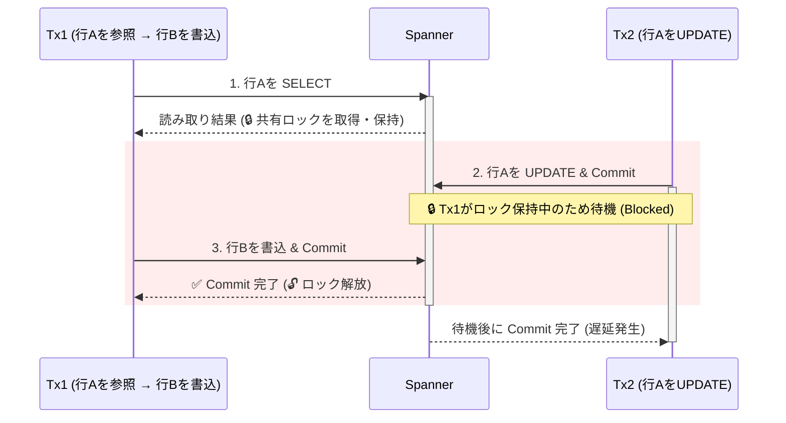
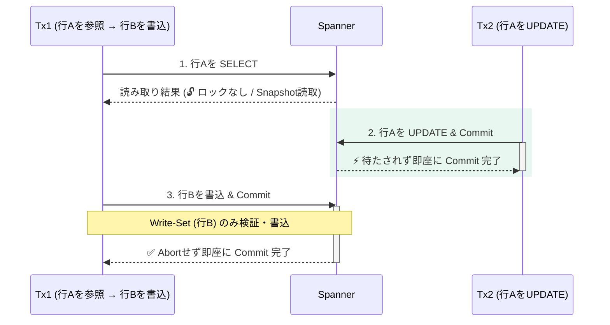
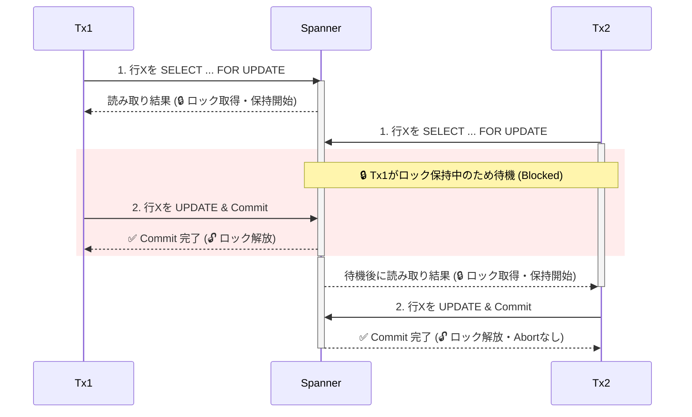
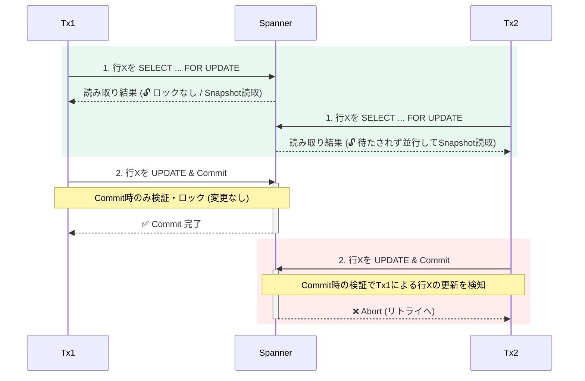

## tl;dr

- SpannerのRepeatable Readは、MySQLなどの一般的なRDBからの移行を容易にするだけでなく、Read-Write競合が発生するトランザクションのレイテンシを短縮する効果があります。
- 特に多くの参照と一部の更新が混在するワークロード（Read-Write競合）では、読み取り時のロック待ちがなくなることでテールレイテンシ（p99）が半減し、並行する更新トランザクションのコミットも高速化されます。
- 新規アプリケーションではデータ整合性が最も高い標準の`Serializable`を基本としつつ、Read-Write競合がボトルネックとなるトランザクションに絞って`Repeatable Read`へオプトインする使い分けが推奨されます。

## はじめに

Spannerは長らく、Read-Writeトランザクションの分離レベルとして最も厳格な`SERIALIZABLE`のみを提供してきました。その後、新たに[**Repeatable Read**](https://docs.cloud.google.com/spanner/docs/isolation-levels)分離レベルに対応しました[1]。

このRepeatable Readは、MySQLやPostgreSQLなどの一般的なリレーショナルデータベース（以下、RDB）で構築された既存のアプリケーションを、更新時のロジックを変えずにSpannerへ移行するための機能として紹介されることが多いと感じています。

一方で、内部の並行性制御の仕組みに目を向けると、Repeatable Readは「移行時の互換性確保」だけでなく、**「Read-Write競合下でのレイテンシとスループットの改善」**というパフォーマンスチューニングの選択肢としての側面も持っています。

本稿では、標準の`Serializable`と`Repeatable Read`で内部のロック制御がどのように異なるのかを整理した上で、東京リージョンのSpannerインスタンス（1,000 Processing Units）とGo SDK（`cloud.google.com/go/spanner` v1.95.1）を用いて実測したレイテンシ比較を紹介します。また、公式ドキュメントの推奨指針に基づき、どのような場面でRepeatable Readを選択すべきかを解説します。

> **※注記**：本稿に掲載しているレイテンシやスループットの測定値は、手元の検証環境で試行した際の**参考情報**であり、実際の環境やワークロードによって数値は異なります。

---

## SerializableとRepeatable Readの仕組みの違い

実測結果を見る前に、Spannerにおける`Serializable`と`Repeatable Read`の制御方式の違いを整理します。

Spannerのデフォルト設定では、`Serializable`は**PCC（`Pessimistic`）**、`Repeatable Read`は**OCC（`Optimistic`）**で動作します[2]。設定によりロックモードを個別に組み合わせることも可能ですが、本稿ではまずこの標準設定同士を比較します（標準以外の組み合わせについては後半で補足します）。

### カフェの利用で考えるPCCとOCC

データベースの並行性制御には、**悲観的並行性制御（PCC / Pessimistic）**と**楽観的並行性制御（OCC / Optimistic）**の2つのアプローチがあります。

この2つの違いを直感的にイメージするため、**一般的なカフェを利用する場面**を想定してみます。カフェでは、空いている時間帯は先に注文してから席を探しますが、混雑時には店員さんから「お席の確保を先にお願いします」とアナウンスされていることが多いと思います。

* **PCC（悲観的並行性制御）の場合**：
  **先に席を確保してから、商品を受け取って席につくイメージ**です。
  レジに並んだり商品を受け取ったりしている間もずっと席を押さえているため、1人が席を取っている時間が長くなり、店全体として席が埋まっている時間が相対的に長くなります。一方で、商品を受け取ったあとに席を探し回る必要がなく、確実に席に座ることができます。
* **OCC（楽観的並行性制御）の場合**：
  **先に商品を受け取ってから、空いている席を探して着席するイメージ**です。
  注文して受け取るまでの間は席を押さえないため、1人が席を取っている時間が短くなり、店の運営全体としては回転が良くスムーズに回ります。一方で、店内が混雑してくると、トレイを持ったまま座席を探し回る必要が出てきます。最悪の場合には席が見つからず立って待つ可能性もあります。


### Spanner内部でのロックと検証の動作

上記のPCCとOCCの違いを踏まえて、Spannerが`Serializable`と`Repeatable Read`で実際にどのような制御を行っているのかを見てみます。

マニュアルには、SpannerのRepeatable Readについて以下のような説明がされています[1]。

> Repeatable read isolation uses snapshot isolation under the hood. Within a read-write transaction, all reads see a consistent snapshot of the database taken at a single timestamp.

**トランザクション内の通常の`SELECT`クエリーは、ロックを一切取得せず、最初の読み取りまたはクエリーが実行された時点のスナップショットを読むだけで完結するイメージです[5]。**

※厳密なロック・検証の粒度は「セル（行×列）およびスキャン範囲」ですが、以降の解説と図解では分かりやすく行単位で表現します[4]。

| フェーズ | Serializable（標準 / Pessimistic） | Repeatable Read（標準 / Optimistic） |
| :--- | :--- | :--- |
| **1. 通常の`SELECT`実行時** | Paxosリーダー上で対象データに**共有ロック（`ReaderShared`）**を取得する。他トランザクションが書き込みロック（`WriterShared` / `Exclusive`など）を保持中なら待機する。 | **ロックを取得しない**。スナップショット時点のデータをそのまま読み取る。 |
| **2. トランザクション実行中** | 読み取ったセル・範囲の共有ロックをCommitまで保持し続ける（同じ対象への他トランザクションの更新をブロックする）。 | 読み取りロックを持たないため、他トランザクションが同じ対象を並行して更新しても互いに干渉しない。 |
| **3. `Commit`実行時** | 全Readロックが有効か確認し、書き込み対象のロック（未読データなら`WriterShared`、既読データなら`Exclusive`へ昇格）を取得してPaxos合意を行う。 | 書き込み対象（Write-Set）や`SELECT ... FOR UPDATE` / `LOCK_SCANNED_RANGES=exclusive`指定範囲、制約確認等でDMLが内部参照するデータのみ変更有無を検証してCommitする[1][2]。 |

本記事の主役である**Read-Write競合**について、具体的な動作をシーケンス図で確認します。

ここでは、「`Tx1`が商品マスタ（行A）を通常の`SELECT`で参照したあと、注文テーブル（別行B）に書き込む」最中に、「裏で`Tx2`が同じ商品マスタ（行A）を`UPDATE`する」場合の動きを比べます。

#### ① Serializable（標準 / Pessimistic：Read時からロックして他を待たせる）

`Tx1`が更新しない行Aであっても、通常の`SELECT`を実行した時点で共有ロック（`ReaderShared`）を取得し、`Commit`完了まで保持し続けます。そのため、裏から来た`Tx2`の更新はロック解放までブロックされます。



#### ② Repeatable Read（標準 / Optimistic：ロックせず読み、参照のみなら検証もしない）

`Tx1`の`SELECT`はロックを取らず、さらに参照しただけの行Aは`Commit`時の変更検証対象にも含まれません（表のフェーズ3参照）。そのため、裏で`Tx2`が行Aを更新しても、**ロック待ちも`Commit`時のAbortも一切発生せず、双方が待たずに即座に完了**できます。



このように、`Repeatable Read`（OCC）では**「Read時にロックを取らない」だけでなく、「通常の`SELECT`に対してはCommit時にも他トランザクションによる変更の有無を検証しない」**という点が最大のポイントです。
その結果、参照しただけのマスタ行が裏で頻繁に更新されていても、互いに干渉することなく並列に処理を進められます。

---

## 実測検証

この仕組みの違いによって、実際のアプリケーションが体感するレイテンシがどれぐらい変わるのかを確認するため、3つの異なるワークロードでベンチマークを実施しました。

### 準備

測定環境の構成は以下の通りです。ネットワーク経路の揺らぎを最小化するため、同一ゾーンのCompute Engine VMからDirect Connectivityを有効にして接続しています。

* **クライアント環境**：Compute Engine `n4-standard-2`（2 vCPU, 8 GB RAM, `asia-northeast1-b`）
* **Spanner環境**：`regional-asia-northeast1`（東京リージョン）、1,000 Processing Units（1 Node, Enterprise Edition）
* **通信経路**：Direct Connectivity有効（`GOOGLE_SPANNER_ENABLE_DIRECT_ACCESS=true`）
* **ソフトウェア**：Go 1.26.6、`cloud.google.com/go/spanner` v1.95.1（4 gRPC Channels）

検証用のスキーマとして、ECサイトの商品マスタと注文テーブルを模した以下の2つのテーブル（`Products`および`Orders`）を作成し、10カテゴリ×各100商品（計1,000行）の初期データを投入しました。

```sql
CREATE TABLE Products (
  category_id INT64 NOT NULL,
  product_id INT64 NOT NULL,
  name STRING(128) NOT NULL,
  stock INT64 NOT NULL,
  sales_count INT64 NOT NULL,
  updated_at TIMESTAMP NOT NULL OPTIONS (allow_commit_timestamp=true),
) PRIMARY KEY (category_id, product_id);

CREATE TABLE Orders (
  order_id STRING(64) NOT NULL,
  category_id INT64 NOT NULL,
  product_id INT64 NOT NULL,
  quantity INT64 NOT NULL,
  total_stock_snapshot INT64 NOT NULL,
  created_at TIMESTAMP NOT NULL OPTIONS (allow_commit_timestamp=true),
) PRIMARY KEY (order_id);
```

Go SDKでは、`ReadWriteTransactionWithOptions`に`TransactionOptions`を渡すことで、同じ`spanner.Client`を使いながらトランザクションごとに分離レベルを切り替えられます。

```go
// Serializable（標準設定：PESSIMISTIC がデフォルト）で実行する場合
optsSerializable := spanner.TransactionOptions{
    IsolationLevel: sppb.TransactionOptions_SERIALIZABLE,
    ReadLockMode:   sppb.TransactionOptions_ReadWrite_PESSIMISTIC,
}

// Repeatable Read（標準設定：OPTIMISTIC がデフォルト）で実行する場合
optsRepeatableRead := spanner.TransactionOptions{
    IsolationLevel: sppb.TransactionOptions_REPEATABLE_READ,
    ReadLockMode:   sppb.TransactionOptions_ReadWrite_OPTIMISTIC,
}

_, err := client.ReadWriteTransactionWithOptions(ctx, func(ctx context.Context, txn *spanner.ReadWriteTransaction) error {
    // トランザクション処理
    return nil
}, optsRepeatableRead)
```

なお、`ReadLockMode`を省略した場合もそれぞれ標準のロックモードが自動選択されるほか、`spanner.ClientConfig`でクライアント全体のデフォルト設定を指定することもできます。

### 実行

以下の3つのシナリオで、`Serializable`と`Repeatable Read`のEnd-to-End（以下、E2E）レイテンシ、各フェーズの内訳、およびAbort発生率を比較しました。あわせて、Spannerの組み込み統計ビューである`SPANNER_SYS`を用いてサーバー側の内部統計も確認しています。

1. **Scenario 1（競合なし・`c=1`）**：他のトランザクションが一切動いていない状態で、1並列で500トランザクションを直列実行し、純粋なオーバーヘッドの差を測定する。
2. **Scenario 2（Read-Write競合・`c=12 + 4`）**：共通の`Products`テーブルに対して、裏で更新トランザクションが動く中で参照＋`Orders`への追記を行う。
3. **Scenario 3（高Write-Write競合・`c=8`）**：20行のホットな`Products`レコードに対して、8並列で同時に`SELECT ... FOR UPDATE`と`UPDATE`を実行する。

---

### Scenario 1：競合なし環境でのベースライン比較

まずは競合がまったくない状態（`Concurrency = 1`、各500回実行）での比較です。ここでは以下の2パターンを計測しました。

* **Scenario 1A（複数Read＋Write）**：`Products`の範囲スキャン20行（最初の読み取りと同時にトランザクションを開始）＋主キー指定の1行Readを実行したあと、`Orders`に1行`INSERT`して`Commit`する。
* **Scenario 1B（Read-Writeトランザクション内でReadのみ）**：フレームワークやORマッパー（Springの`@Transactional`など）でRead-Writeトランザクションを開始したものの、条件判定の結果DMLを実行せずに2回の`SELECT`だけで`Commit`する。


| シナリオ | 分離レベル | E2E p50 | E2E p90 | E2E p99 | Commit p50 | サーバー側統計 (`SPANNER_SYS.TXN_STATS_TOP_MINUTE`) |
| :--- | :--- | :---: | :---: | :---: | :---: | :--- |
| **Scenario 1A**<br>*(2 Reads + 1 Insert)* | **Serializable** | 14.32 ms | 15.11 ms | 22.13 ms | 4.46 ms | `avg_total`: 12.99 ms (`avg_commit`: 2.07 ms) |
| | **Repeatable Read** | **13.71 ms**<br>(-4.2%) | **14.77 ms**<br>(-2.3%) | **18.37 ms**<br>(-17.0%) | **4.00 ms**<br>(-10.3%) | `avg_total`: **12.29 ms** (`avg_commit`: 2.23 ms) |
| **Scenario 1B**<br>*(2 Reads + Commitのみ)* | **Serializable** | 9.47 ms | 11.06 ms | 11.96 ms | 3.39 ms | 500件記録 (`avg_commit`: 0.83 ms) |
| | **Repeatable Read** | **7.76 ms**<br>(-18.0%) | **9.00 ms**<br>(-18.6%) | **11.57 ms**<br>(-3.3%) | **1.82 ms**<br>(-46.4%) | **記録なし**（上位統計の対象外） |

#### 結果の考察

競合が一切ない状態での結果を比較すると、DMLを伴う場合と伴わない場合で対照的な傾向が見られます。

1つ目は、**Scenario 1A（書き込みあり）では競合がない限りp50ベースでの差がごくわずかである点**です。クライアント側のCommit p50やE2E p99はやや改善しているものの、サーバー側の平均Commit時間（`avg_commit`）は`2.07 ms`対`2.23 ms`とほぼ同等で、単発計測におけるばらつきの範囲にとどまります。つまり、競合がなく実際に書き込みを行うトランザクションでは、分離レベルの違いだけで劇的な差は出ません。

2つ目は、対照的に**Scenario 1B（更新なしでCommitするRead-Writeトランザクション）において、Commit RPCが`3.39 ms`から`1.82 ms`（-46.4%）へとほぼ半減し、E2E p50が18.0%短縮されている点**です。
本来、読み取りしか行わない処理には`ReadOnlyTransaction`を使うのがSpannerのセオリーですが、既存のRDBから移行したアプリや共通ミドルウェアの都合で「とりあえずRead-Writeトランザクションを開いて`SELECT`し、更新対象がなければそのままCommitする」というコードになっているケースは少なくありません。

`Serializable`では、`SELECT`した時点でPaxosリーダー上に共有ロック（`ReaderShared`）が確保されるため、書き込みがゼロでもCommit時にリーダー側でロック解放処理が走ります。一方、`Repeatable Read`ではロックもCommit時の整合性検証状態も保持しないため、書き込み（および`FOR UPDATE`検証）を伴わないCommitはデータプレーン側の重い処理を伴わずに高速に完了でき、リソース消費上位を集計する`SPANNER_SYS.TXN_STATS_TOP_MINUTE`にも記録されませんでした[2]。なお、このように書き込みを実行せずCommitするRead-Writeトランザクションでは、読んだデータがCommit時点まで変更されていない保証はない点には留意が必要です[5]。

---

### Scenario 2：Read-Write競合ワークロードでの効果

次に、実務のOLTPアプリケーションで最も頻繁に発生する**Read-Write競合**のシナリオです。

ここでは、人気カテゴリ（`category_id = 1`の20商品）に対して以下の2種類のワーカーを同時に走らせました。

* **主トランザクション（12並列・計600トランザクション）**：`Products`の上位20行を範囲スキャンして集計し、さらに同じ対象範囲の累計売上数（`SUM(sales_count)`）を確認する2つ目の`SELECT`を実行した上で、`Orders`テーブルに新しい注文1行（UUID主キー）を`INSERT`して`Commit`する。
* **バックグラウンド更新ワーカー（4並列）**：同じ`category_id = 1`の商品の売上数（`sales_count`）を15 ms間隔で継続的に`UPDATE`し続ける。

つまり、**「主トランザクションは`Products`を読むだけで書き換えはしない（書き込むのは別テーブルの`Orders`）が、読んでいる`Products`の行が裏で頻繁に更新されている」**という状態です。


| 分離レベル | E2E p50 | E2E p99 | 主TX Abort率 | 主TX スループット | 裏Writer E2E p50 | 裏Writer サーバー側Commit (`SPANNER_SYS`) |
| :--- | :---: | :---: | :---: | :---: | :---: | :---: |
| **Serializable** *(標準)* | 17.53 ms | 41.08 ms | 0.17% (1/601) | 598.2 TPS | 10.32 ms | **6.16 ms** *(ロック待ち発生)* |
| **Repeatable Read** | **13.93 ms**<br>(-20.6%) | **20.09 ms**<br>(-51.1%) | **0.00%** (0/600) | **832.6 TPS**<br>(+39.2%) | **9.23 ms** | **2.15 ms**<br>(-65.1%, *ブロックなし*) |

#### 結果の考察

このシナリオでは、`Repeatable Read`の効果が顕著に現れています。

* **主トランザクションのE2Eレイテンシ**：中央値（p50）で`17.53 ms` → **`13.93 ms`（-20.6%）**、p90で`26.79 ms` → **`16.63 ms`（-37.9%）**、p95で`31.61 ms` → **`17.40 ms`（-44.9%）**、そして上位1%のテールレイテンシ（p99）では`41.08 ms` → **`20.09 ms`（-51.1%）と半分以下**に短縮されました。実効スループットも`598.2 TPS`から**`832.6 TPS`（+39.2%）**へ向上しています。
* **裏で動く更新トランザクションへの好影響**：見逃せないポイントとして、主トランザクションだけでなく、**裏で`Products`を更新しているバックグラウンドWriterのサーバー側平均Commitレイテンシも、`6.16 ms`から`2.15 ms`（-65.1%）へと約3分の1に短縮**されています。

この差は、`Products`テーブルに対する共有ロック（`ReaderShared`）の有無から生じています。

`Serializable`（PCC）では、12並列の主トランザクションが`Products`の20行をスキャンするたびに`ReaderShared`ロックを取得し、`Orders`への`INSERT`と`Commit`が完了するまで保持し続けます。そのため、裏Writerが`Products.sales_count`を`UPDATE`しようとするとReadロックの解放待ちが発生し、同時に主トランザクション側も裏Writerの更新ロックに待たされるため、双方のテールレイテンシが大きく伸びています。

実際に測定中の`SPANNER_SYS.LOCK_STATS_TOP_MINUTE`を確認すると、`Serializable`の実行中には以下のようなロック待ちが記録されていました。

```sql
-- SPANNER_SYS.LOCK_STATS_TOP_MINUTE で観測されたロック競合（Serializable実行時）
-- row_range_start_key: products(1,16), lock_wait_seconds: 0.3691
-- sample_lock_requests:
--   ReaderShared:Products.sales_count (transaction_tag: s2_main_s_pess)
--   WriterShared:Products.sales_count (transaction_tag: s2_bg_writer_s_pess)
--   Exclusive:Products.sales_count    (transaction_tag: s2_bg_writer_s_pess)
```

一方、`Repeatable Read`（OCC）では、主トランザクションによる`Products`の読み取りはスナップショットを読むだけでロックを一切取得しません。そのため、主トランザクションは競合なしの時とほぼ変わらないレイテンシで完了し、裏Writer側もReadロックにブロックされずに処理を終えられています。`SPANNER_SYS.LOCK_STATS_TOP_MINUTE`にも、`Repeatable Read`の主トランザクション（`s2_main_rr_opt`）によるロック待ちは1件も記録されませんでした。

#### `ReadOnlyTransaction`に分離する設計との違い

Spannerでは、読み取りのみの操作や書き込み整合性に影響しない事前参照を切り出せる場合は、ロックを取らない`ReadOnlyTransaction`（またはSingle Read）を使うのが基本原則です[5]。もちろん分離できるならその原則に従うのが王道ですが、`Repeatable Read`を使うことには実務上大きな強みがあります。

* **トランザクションの分断とJOIN放棄を避けられる**：1つの業務処理の中で2種類のトランザクションを使い分ける実装は複雑になりやすく、単一スナップショットでの読み取りやRead-Your-Writes（自分の書き込みを読める性質）も保ちにくくなります。さらに、参照を別トランザクションへ切り出すと、**RWトランザクション内のクエリーでマスタテーブルと分散JOINできるSpannerの強みを捨てて、アプリ側でデータを突合する実装を強いられます**。`Repeatable Read`なら1本のRWトランザクションのままマスタ側のロック競合だけを外せます。
* **同一トランザクション内で検証レベルを混在できる**：「参照するだけのマスタ類は通常の`SELECT`（ロックなし・検証なし）にしつつ、整合性を守りたい在庫1行だけは`SELECT ... FOR UPDATE`（Commit時検証）にする」といった柔軟な使い分けが可能です。

---

### Scenario 3：高Write-Write競合（`SELECT ... FOR UPDATE`）でのトレードオフ

ここまでの結果だけを見ると、「すべてのトランザクションをRepeatable Readにすれば速くなるのではないか」と思えるかもしれません。そこで3つ目のシナリオとして、**少数のホットな行を複数ワーカーが同時に奪い合って更新する高Write-Write競合**を検証しました。

ここでは、`category_id = 2`のわずか20商品に対して、8並列のワーカーが同時に以下の在庫引き落としトランザクション（計400回完了するまで）を実行します。

```sql
-- 1. 排他ロック（またはCommit時検証）の対象として在庫を読み取る
SELECT stock, sales_count FROM Products
WHERE category_id = 2 AND product_id = @pid FOR UPDATE;

-- 2. 同じ行の在庫を減らし、売上数を加算する
UPDATE Products
SET stock = stock - 1, sales_count = sales_count + 1, updated_at = PENDING_COMMIT_TIMESTAMP()
WHERE category_id = 2 AND product_id = @pid;
```

> **※補足**：`Repeatable Read`では実際に書き込む対象（Write-Set）がスナップショット以降に変更されていないかは自動検証（First-Committer-Wins）されるため、同一セルを更新するだけなら通常の`SELECT`でもロストアップデート自体は防げます[1][3]。一方で、**読んだ値をもとに別行・別テーブルを更新するケース（Write Skew）や、条件分岐・新規行追加の前提を保証したいケース**では`SELECT ... FOR UPDATE`が必須となります。今回は、一般的なRDBの在庫引き落とし処理で標準的な`SELECT ... FOR UPDATE`を用いた場合の高競合時の挙動を比較しています。

測定結果は以下の通りです。


| 分離レベル | E2E p50 | E2E p90 | E2E p95 | E2E p99 | Abort発生率 (Abort数 / 総試行) | 実効スループット |
| :--- | :---: | :---: | :---: | :---: | :---: | :---: |
| **Serializable** *(標準)* | 12.98 ms | **19.58 ms** | **23.35 ms** | **34.02 ms** | **0.00%** (0 / 400) | **544.6 TPS** |
| **Repeatable Read** | **11.60 ms** | 34.55 ms | 39.07 ms | 65.68 ms (+93.0%) | **16.67%** (80 / 480) | 399.2 TPS (-26.7%) |

#### 結果の考察

Scenario 2とは打って変わって、**p90以降のレイテンシ、Abort率、実効スループットのすべてにおいて標準の`Serializable`が有利**という結果になりました。

* 競合にぶつからなかった回（中央値p50）だけは`Repeatable Read`の方がわずかに速い（`11.60 ms` vs `12.98 ms`）ものの、`Repeatable Read`では**480回の試行のうち80回（16.67%）でCommit時のAbort（やり直し）が発生**し、リトライのバックオフ時間が加算された結果、**p99レイテンシは`34.02 ms`から`65.68 ms`へと約1.9倍に悪化**しています。
* 一方、標準の`Serializable`では**400トランザクション中Abortは0回（0.00%）**であり、スループットも`544.6 TPS`と高速に処理されています。

この逆転が起きる理由は、同じ行（行X）を読み取って更新するトランザクション（`Tx1`と`Tx2`）が同時に走った際の、PCCとOCCの振る舞いの違いにあります。

##### ① Serializable（標準 / Pessimistic：Read時からロックを確保して直列に進む）

最初の`SELECT ... FOR UPDATE`の時点で対象行の排他ロックを取得するため、後続トランザクション（`Tx2`）は`Tx1`のCommit完了までその場で待機し、最新の値を受け取ってから後続の`UPDATE`へ進みます。そのため、Commit段階でのAbortが発生しません。



##### ② Repeatable Read（標準 / Optimistic：ロックせず並走し、Commit時に検証する）

`SELECT ... FOR UPDATE`を実行した時点ではロックを取得せず、スナップショットから値を読み取って並走します。最後の`Commit`のタイミングで競合検証が行われるため（First-Committer-Wins）[2]、先行の`Tx1`がCommitした瞬間に後続の`Tx2`は検証で敗北してAbortとなり、最初からトランザクションをやり直すコストが発生します。



※なお、`Serializable`（PCC）側でこの例に`FOR UPDATE`を付けているのは、通常の`SELECT`だと両者が共有ロックを保持したまま排他ロックへの昇格を待ち合うデッドロックが生じ、Wound-Waitアルゴリズムによって片方（新しいトランザクション）がAbortされるためです[4]。

---

### 補足：標準以外のロックモード組み合わせについて

ここまで比較した標準設定以外に、Spannerでは分離レベルとロックモード（`PESSIMISTIC` / `OPTIMISTIC`）を入れ替えた組み合わせも設定可能です。今回メインの比較から外した理由はそれぞれ以下の通りです。

* **`Serializable + OPTIMISTIC`（OCC）を選ばない理由**：
  Read時のロック取得は省略できるものの、Serializableの整合性を守るため**Commit時に「通常の`SELECT`で読んだ全範囲が他トランザクションに書き換えられていないか」を検証**します。そのため、Read-Write競合環境ではCommit時の検証失敗によるAbortが多発します。なお、マルチリージョン構成で最寄りレプリカから読み取りを返せる利点は、同じくOCCを使う`Repeatable Read`でも同様に得られます（ただしDML書込後の読み取りはリーダーへ向く場合があります）[2]。
* **`Repeatable Read + PESSIMISTIC`（PCC）の挙動**：
  `FOR UPDATE`クエリーやDML実行時に排他ロックを取得して後続の競合更新を直列化できます。トランザクションの最初の文が`SELECT ... FOR UPDATE`であれば、ロック取得後にスナップショットタイムスタンプが確定するため、ロック待ちに起因するAbortは抑えられます[2]。ただし、先行する別クエリーでスナップショットが既に確定している場合はCommit時の検証でAbortが発生し得るほか、通常の読み取りを最寄りレプリカから返せなくなるトレードオフもあります[2]。

---

## どのような場合にRepeatable Readを選ぶべきか（まとめ）

今回の3つのベンチマーク結果をまとめると、`Serializable`と`Repeatable Read`の特性は以下のように整理できます。

| ワークロードの特性 | 有利な分離レベル | 理由と効果（実測結果より） |
| :--- | :---: | :--- |
| **1. 多くのReadと一部のWriteが競合する処理**<br>*(Read-Write競合 / Read-mostly)* | **Repeatable Read** | 参照時に共有ロックを取らずCommit時のRead範囲検証も省けるため、参照側も裏の更新側もブロックされない（**p99が-51.1%短縮、裏WriterのCommitが-65.1%短縮**）。 |
| **2. Read-Writeトランザクション内で結果的に更新を行わずCommitする処理**<br>*(他RDBからの移行・ORマッパー利用時など)* | **Repeatable Read** | 共有ロックの確保・解放が不要になるため、Commit RPCの所要時間がほぼ半減する（**Commit p50が-46.4%短縮、E2E p50が-18.0%短縮**）。 |
| **3. 少数のホットな同一行を`FOR UPDATE`で同時に更新し合う処理**<br>*(高Write-Write競合)* | **Serializable**<br>*(Spanner標準)* | 先に排他ロックを取得して直列化する方が、標準設定（OCC）のCommit時検証失敗によるAbort＆リトライ（無駄足）を防げる（**Abort率 0% vs 16.67%、p99が約半分**）。 |

### 実務での使い分け指針

最後に、Spannerの公式ドキュメント[1]で示されている推奨アプローチに沿って、実務での選択指針を整理します。

#### 他のRDB（MySQL / PostgreSQLなど）から移行する場合

移行元のデータベースのデフォルト分離レベルに近い挙動となるため、`Repeatable Read`をベースとして構成することが推奨されています。既存の更新ロジックやORマッパーのトランザクション境界を大きく作り直すことなく、Spannerの共有ロックに起因する意図しないロック待ちを回避できます。

#### Spanner上で新規に構築する／既存アプリに適用する場合

基本はあくまで**デフォルトの`Serializable`から始める（Start with Serializable）**のが安全です。高並行時にのみ発生する複雑なタイミングバグやWrite Skew（読み取った前提が裏で覆ることによる不整合）を、アプリケーション側で意識せずに防げるためです。

その上で、**以下の条件に当てはまるトランザクションに絞って、ピンポイントで`Repeatable Read`へオプトインする**使い方が最も合理的です。既存アプリ全体を無差別に一括変更すると、隠れていたWrite Skewが顕在化する恐れがあるため推奨されません。

* 多くの行を参照・JOINしながら別テーブルへ書き込んでおり、`ReadOnlyTransaction`への分離が難しい
* `SPANNER_SYS.LOCK_STATS_TOP_MINUTE`で`ReaderShared`と書き込みロック（`WriterShared` / `Exclusive`）の競合が観測されている

なお、ECサイトの例に当てはめると、「参照した商品情報の転記や集計値の記録」のような処理なら通常の`SELECT`で問題ありません。一方で、「在庫残高を引き当てる」「利用上限をチェックして更新可否を分岐させる」といった**読んだ値に基づいて整合性条件を判定する処理**では、`Repeatable Read`にする場合でも`SELECT ... FOR UPDATE`を併用するか、`Serializable`のまま維持する必要があります。

Repeatable Readは「他のRDBから移行するときの互換性維持機能」としてだけでなく、Read-Write競合がボトルネックとなる箇所をピンポイントに高速化するチューニング手段としても活用できます。ワークロードの特性と必要な整合性要件に合わせて使い分けてみてください。

## 参考リンク

- [1] [Isolation levels overview | Cloud Spanner Documentation](https://docs.cloud.google.com/spanner/docs/isolation-levels)
- [2] [Concurrency control | Cloud Spanner Documentation](https://docs.cloud.google.com/spanner/docs/concurrency-control)
- [3] [Use repeatable read isolation | Cloud Spanner Documentation](https://docs.cloud.google.com/spanner/docs/use-repeatable-read-isolation)
- [4] [Use SELECT FOR UPDATE in serializable isolation | Cloud Spanner Documentation](https://docs.cloud.google.com/spanner/docs/use-select-for-update-serializable)
- [5] [Transactions overview | Cloud Spanner Documentation](https://docs.cloud.google.com/spanner/docs/transactions)
